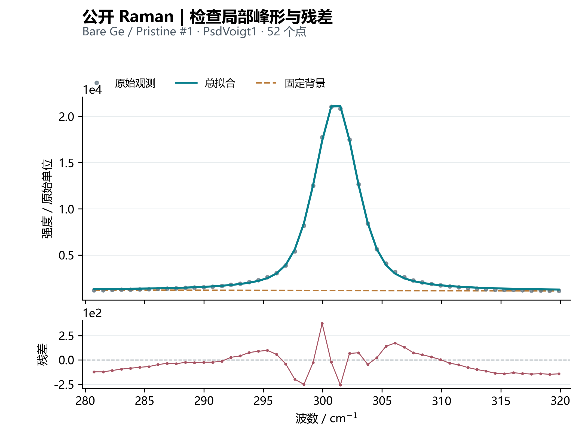

# 材料科研谱线拟合工具

在本机浏览器中完成一维谱线拟合：支持 通用单峰拟合（含 Raman）、XRD 单峰拟合和独立的 XPS 多峰拟合工作台，可检查基线、参数约束、残差与连续模型峰性质，并导出 CSV、PNG 和 XPS 配置。

**[中文使用手册](docs/USER_GUIDE.md)** · **[公开实谱与复现](examples/public/README.md)** · **[合成练习](examples/README.md)**



图文手册按当前界面更新，包含实际操作截图与公开实谱拟合图，演示 Raman、XRD、XPS 的选列、区间、参数弹窗、配置恢复和残差诊断。数据来自 [Gnatyuk 等的 Zenodo 数据集](https://doi.org/10.5281/zenodo.18845748)；[完整署名和处理说明](examples/public/README.md)。

## 功能

| 模式 | 峰形 | 背景与分析 |
| --- | --- | --- |
| 通用单峰拟合、XRD 单峰拟合 | Gaussian、Lorentz、PsdVoigt1、PsdVoigt2、Split Pseudo-Voigt、双方向 EMG | 无基线、常数、直线、多项式、Spline、B-Spline；初值估计、参数约束、模型比较 |
| XPS 多峰拟合 | 上述峰形中除 PsdVoigt2 外的六种，可混合 | 无背景、直线、静态 Shirley；候选峰、双峰组、峰位/面积/宽度关联、能量偏移 |

峰面积 `A` 为模型全域积分面积，峰位 `xc` 为实际峰顶。请区分整体 FWHM、模型内部宽度和区间面积；数值收敛不等于模型适用或化学态归属正确。详细口径见手册。

## Windows 快速开始

1. 安装 Python 3.10～3.12（推荐 3.11/3.12）以及包含 npm 的 Node.js 18 或更高版本。当前 NumPy 1.x 依赖不适用于 Python 3.13/3.14。
2. 下载仓库 ZIP 并解压，或克隆仓库；进入含 `一键启动.bat` 的目录。
3. 双击 **`一键启动.bat`**。首次启动需要联网，脚本创建 `.venv` 并安装依赖。
4. 浏览器自动打开 <http://127.0.0.1:5175/>。导入 `examples/public/zenodo_18845748/Raman.xlsx`，选择 `Bare Ge / Wavenumber / Pristine #1`，按[图文教程](docs/USER_GUIDE.md#首次拟合教程)操作。
5. 结束时回到启动窗口按回车，停止本次启动的前后端。仅关闭网页不会停止服务。

```powershell
# 在项目根目录执行；不自动打开浏览器
.\一键启动.bat -NoBrowser

# 检查前后端 HTTP 服务，成功后自动停止
.\一键启动.bat -Check
```

手动安装、双终端启动和构建后单服务运行，见[安装与启动](docs/USER_GUIDE.md#安装与启动)。

## 数据与结果

- 导入 CSV、TXT、TSV、DAT、XY、XYE、XLS、XLSX、XLSM，单文件上限为 25 MiB；支持选择工作表及 X/Y 列。
- 本地服务在内存中处理导入数据，不覆盖原文件。刷新页面会丢失当前工作状态，请及时导出。
- 单峰可导出曲线 CSV、参数 CSV、拟合图 PNG；XPS 另支持导出和重新加载配置 JSON。
- 仓库附带经核验、按 CC BY 4.0 署名转载的公开 Raman/XRD/XPS 原谱，以及合成练习；个人实验数据、历史分析输出、缓存和日志不随仓库发布。

## 开发与验证

后端为 FastAPI、NumPy、SciPy、pandas；前端为 Vue 3、TypeScript、Vite、Plotly。

```powershell
# 在项目根目录，先完成依赖安装
.\.venv\Scripts\python.exe -m unittest discover -s backend/tests -v

# 进入前端目录
cd frontend
npm.cmd run test -- --run
npm.cmd run build
```

公开教程可独立复算（含原文件校验）：

```powershell
.\.venv\Scripts\python.exe examples/public/reproduce.py
```

`backend/tests/validate_xps_real.py` 和 `validate_asymmetric_real.py` 是历史实谱回放脚本，依赖旧目录布局及未随仓库发布的 `data/analysis/` 历史档案，不能在全新克隆中直接运行；常规单元测试不依赖这些历史实谱。

```text
backend/app/       数据导入、基线、峰形、求解与 HTTP 接口
backend/tests/     数值、约束及导出测试；可选的历史实谱回放脚本
frontend/src/      单峰/XRD 页面、XPS 工作台及前端测试
examples/          公开原谱、教学配置、复算脚本与合成练习
docs/              中文使用手册
start.ps1          Windows 启动与检查脚本
一键启动.bat        双击启动入口
```

## 当前边界

XRD 模式提供单峰拟合和轴单位标识，不执行晶相鉴定、仪器展宽扣除或晶粒尺寸计算。XPS 暂不包含 Tougaard、多重态专用模型、自动化学态归属、RSF 定量、测量误差加权或批量联合拟合。派生峰性质暂不计算标准误或置信区间。

本项目面向本机使用，未提供用户认证或面向公网的部署配置。
