# 材料科研谱线拟合工具使用手册

适用对象：需要检查一维材料谱线峰位、峰宽、峰面积及拟合残差的使用者。本文依据当前仓库实现编写，更新日期为 2026-10-13。本版以已核验来源的公开 Raman、XRD、XPS 实谱演示操作，并附实际界面截图和拟合图。教学分析不代替原作者结论或化学态判断。

## 目录

1. [安装与启动](#安装与启动)
2. [首次拟合教程](#首次拟合教程)（公开 Raman 实谱）
3. [导入自己的数据](#导入自己的数据)
4. [单峰与 XRD 操作](#单峰与-xrd-操作)
5. [峰形与参数口径](#峰形与参数口径)
6. [XPS 多峰操作](#xps-多峰操作)
7. [读懂结果](#读懂结果)
8. [导出与恢复](#导出与恢复)
9. [常见问题](#常见问题)
10. [复现与实现依据](#复现与实现依据)
11. [通用多峰与批量顺序拟合](#通用多峰与批量顺序拟合)

### 界面与键盘操作

右上角分别选择“分析类型”和“处理方式”。分析类型分为通用谱线、XRD 峰拟合和 XPS 峰拟合；处理方式分为单谱拟合和批量拟合。峰数由手动添加的峰决定。切换分析类型不会转换数据或单位，各类型的单谱配置和批量草稿分别保留在当前页面会话中。

| 分析类型 | 适用场景 | X 轴要求 |
| --- | --- | --- |
| 通用谱线 | Raman 等一维谱线的单峰或多峰分析 | 使用原文件单位；界面显示 X/Y |
| XRD 峰拟合 | 一个或多个衍射峰的峰位、宽度和面积 | 2θ，单位为 ° |
| XPS 峰拟合 | 同一能区的多分量与双峰约束 | 结合能，单位为 eV |

三种分析类型均可使用批量拟合。批量策略可选“独立拟合”（各谱从同一模板开始）或“顺序拟合”（继承上一条有效结果）。读取、预检或运行批次时导航暂时锁定；暂停须等当前谱求解返回后才可切换。

单谱与批量图表均关闭滚轮缩放，滚轮用于滚动页面。需要调整图表视图时，使用工具栏的“框选缩放”“放大”“缩小”，或通过“重置坐标轴”恢复视图；这些视图操作不修改分析区间或拟合结果。

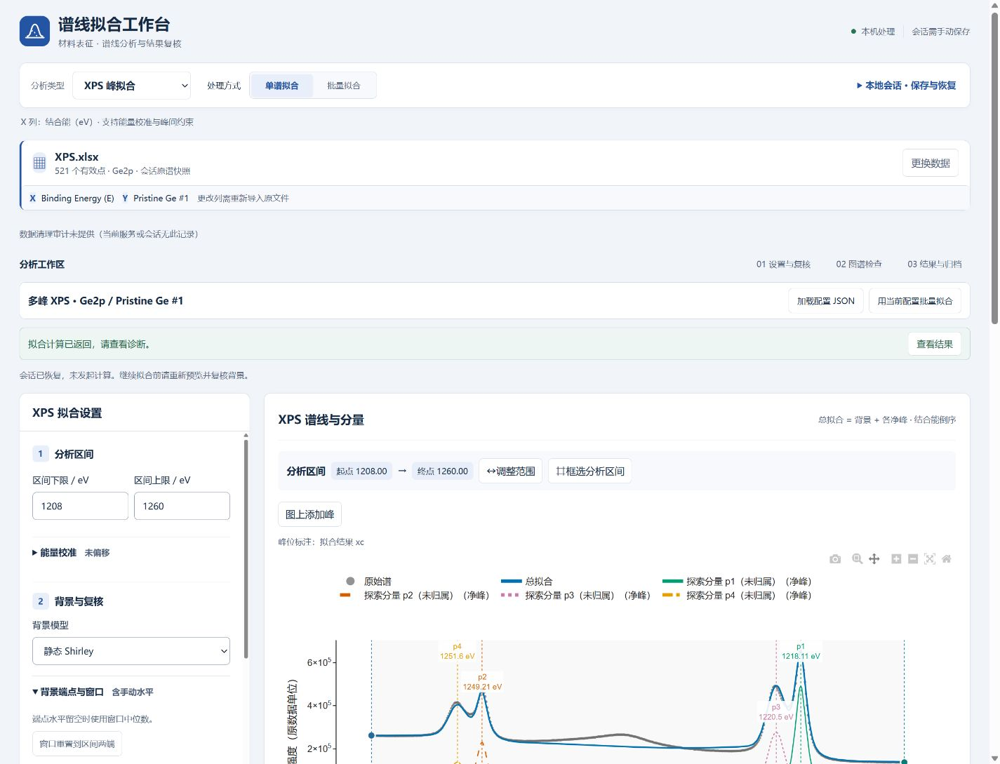

**界面总览。** 新版采用浅色科研工作台与深蓝主操作，截图展示公开 XPS 数据。下文部分功能示例保留上一版配色，入口位置以本节为准。科研图表中的连线仅连接已有采样点。

- **顶部数据栏**：核对文件、工作表、X/Y 列与有效点数；在“查看全部数据 / 更改列”弹窗中修改后点击“应用到图表”。
- **左侧拟合设置**：按“分析区间”“基线／背景与复核”“峰与参数”排列；通用／XRD 使用“统一调整峰参数”，XPS 使用逐峰“参数”按钮；求解设置按需展开。
- **右上分析画布**：查看原谱、基线、拟合曲线和残差；“调整范围”与“框选分析区间”修改分析区间，“操作说明”按需展开。
- **右下拟合结果**：先读峰性质与质量摘要，再展开参数、诊断和求解过程，最后导出。

界面以浅灰蓝背景、白色面板和深蓝操作区分层级，科学曲线保留原有颜色和线型。桌面设置栏内容独立滚动，底部固定显示拟合按钮与阻塞原因；窄屏按设置、画布、结果纵向排列，可用“设置与复核／图谱检查／结果与归档”直接跳转。顶部“本地会话”管理手动保存与恢复。

“加载配置 JSON”和“用当前配置批量拟合”集中在工作区工具栏；单峰的曲线、参数、图片和配置下载集中在结果底部，多峰结果从“导出”展开。“方案敏感性比较”和“分析摘要”统一位于结果下方的“比较与归档”。

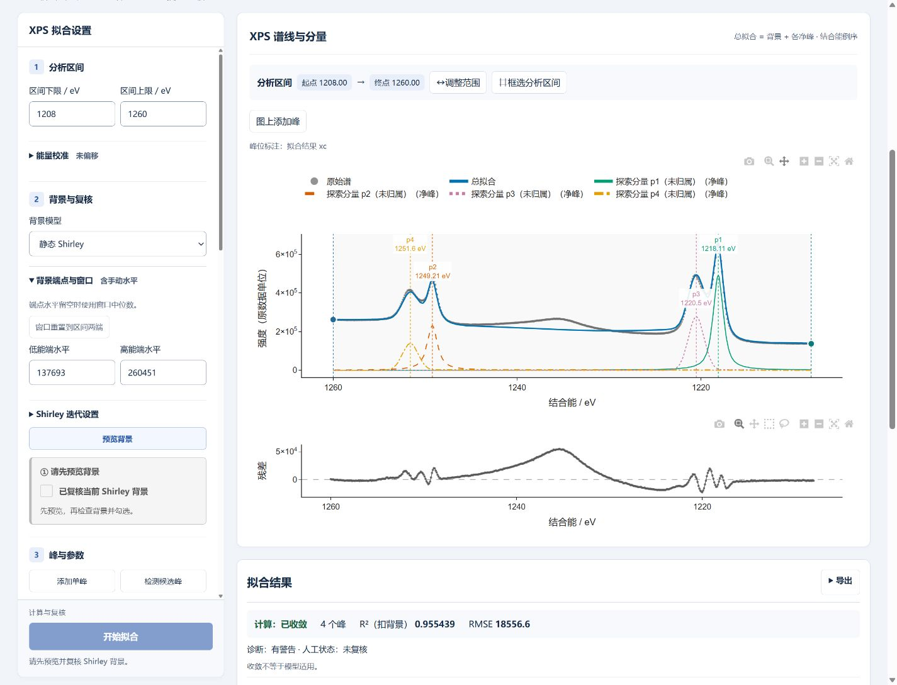

批量工作区先查看背景概览与逐谱复核，再查看峰参数趋势和批次归档。“批次浏览”可直接跳转各区域；运行／暂停与批次导出在顶部，上一条／下一条／当前谱导出在当前谱标题下方。

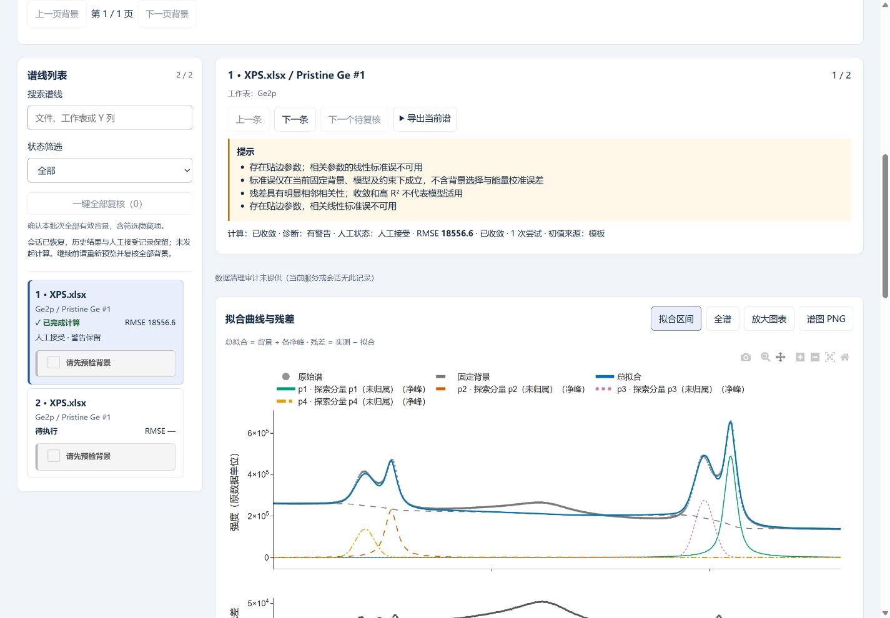

全部峰参数表在弹窗内滚动，底部“撤销本次修改／完成”保持可见。窄屏结果表仅在表格内横向滚动，图谱与页面纵向阅读。

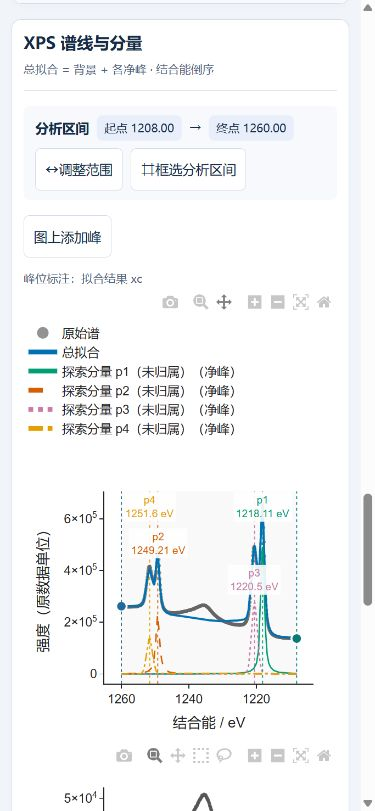

| 键盘操作 | 效果 |
| --- | --- |
| 峰名称上按 Enter 或空格 | 打开只读详情并突出对应曲线 |
| Tab / Shift+Tab | 依次定位控件 |
| 调整区间时按 Esc | 收起区间手柄 |
| 参数弹窗中按 Esc | 关闭弹窗并保留修改，焦点返回编辑按钮；撤销请点击“撤销本次修改” |
| 结果弹窗中按 Esc | 返回总览，焦点回到原峰名按钮 |
| 工作保护弹窗中按 Esc | 取消替换并保留当前工作 |

常用说明已精简，详细解释放在“如何选取区间”“基线与拟合的关系”“参数含义”和“操作说明”中。错误原因、约束要求和结果警告仍直接显示。计算期间修改设置会使旧响应失效；页面不会用旧响应覆盖当前设置，但这不表示后端计算已被中断。

## 安装与启动

### 环境准备

Windows 启动脚本要求 Python 3.10～3.12，以及 Node.js 18 或更高版本（含 npm）。Python 推荐使用 3.11 或 3.12；依赖中的 NumPy 要求 `>=1.26,<2`，不要直接用 Python 3.13/3.14 创建环境。后端依赖范围见 `backend/requirements.txt`，前端锁定版本见 `frontend/package-lock.json`。

可在 PowerShell 检查：

```powershell
python --version
node --version
npm.cmd --version
```

下载项目后先解压到可写目录。以下命令均从项目根目录执行，不要求固定磁盘或用户名。

### Windows 一键启动

双击 `一键启动.bat`。脚本先检查 5175、5176 端口，然后创建或复用项目 `.venv`、安装后端依赖；缺少前端依赖时使用 `npm ci` 安装。首次安装需要联网。

启动后打开 <http://127.0.0.1:5175/>。保留启动窗口，结束时按回车；脚本只停止本次启动的服务。日志在 `.logs/`。也可以运行 `一键启动.bat -NoBrowser` 或 `一键启动.bat -Check`；后者在前后端返回 HTTP 200 后退出，不进行数值正确性验证。

### 手动安装与双终端启动

确认 `python --version` 在上述范围内，再安装：

```powershell
python -m venv .venv
.\.venv\Scripts\python.exe -m pip install -r backend/requirements.txt
cd frontend
npm.cmd ci
cd ..
```

第一个 PowerShell 窗口，在根目录启动后端：

```powershell
.\.venv\Scripts\python.exe -m uvicorn app.main:app --app-dir backend --host 127.0.0.1 --port 5176
```

第二个 PowerShell 窗口，从根目录进入前端并启动：

```powershell
cd frontend
npm.cmd run dev -- --host 127.0.0.1
```

访问 <http://127.0.0.1:5175/>。手动启动时分别在两个窗口按 Ctrl+C 停止。开发前端固定请求本机 5176 后端，因此不要只改后端端口后期待页面自动适配。

### 构建后单服务运行

完成依赖安装后，可先构建前端，再启动后端：

```powershell
cd frontend
npm.cmd run build
cd ..
.\.venv\Scripts\python.exe -m uvicorn app.main:app --app-dir backend --host 127.0.0.1 --port 5176
```

此时访问 <http://127.0.0.1:5176/>。后端在启动时检测 `frontend/dist` 并挂载静态页面；必须先构建、后启动。该方式仍面向本机，不是公网服务部署方案。

## 首次拟合教程

本教程采用 Gnatyuk 等公开的锗材料谱数据，数据集 DOI 为 [10.5281/zenodo.18845748](https://doi.org/10.5281/zenodo.18845748)，许可为 CC BY 4.0。原文件、完整署名、关联出版物、校验和与处理说明见[公开数据说明](../examples/public/README.md)。三份工作簿已随仓库提供，下载整个项目即可复现。

### 第一步：选对工作表和谱列

1. 点击“导入实验数据”，打开 [Raman.xlsx](../examples/public/zenodo_18845748/Raman.xlsx)。
2. 导入后自动打开核对弹窗，先浏览工作表全部数据（每页 100 行，支持跳页），再选择工作表 **Bare Ge**、X 列 **Wavenumber**、Y 列 **Pristine #1**，点击“应用到图表”。
3. 检查顶部文件名和列名。表格共 1601 行，数值清理后用于显示的有效配对点为 1600；两者不是同一统计口径。

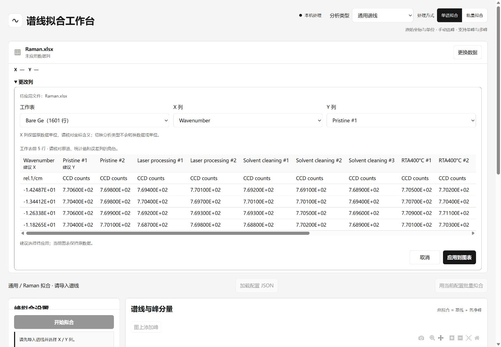

**图 1｜导入与谱列核对。** 截图展示待应用的 Bare Ge 原谱和原始行预览，点击“应用到图表”之前不会加载建议列或清除旧分析。默认工作表 `Figure2bc` 存放峰位和峰宽统计，**不是待拟合原谱**。不要直接对默认选择开始拟合。

### 第二步：设置区间和基线

在“1 分析区间”中将下限设为 **280**、上限设为 **320**，输入后检查主图上方的区间数值已同步。选择“直线”，本例不添加手动锚点，使用区间两端的自动估计；点击“预览基线”，检查后勾选“已复核当前基线”。

**明确分析区间。** 输入的是 280～320 cm⁻¹，真正参与拟合的是其中的 52 个采样点，实际端点约为 280.734 和 319.882 cm⁻¹。主图仍可显示完整光谱，改变拟合区间并不等于自动缩放视图。

### 第三步：选择峰形并拟合

在“统一峰函数”选择 **PsdVoigt1**，点击“添加峰”，再点击“自动估计并采用初值”，保持默认分阶段求解，点击“开始拟合”。本例没有手动固定参数或额外边界。

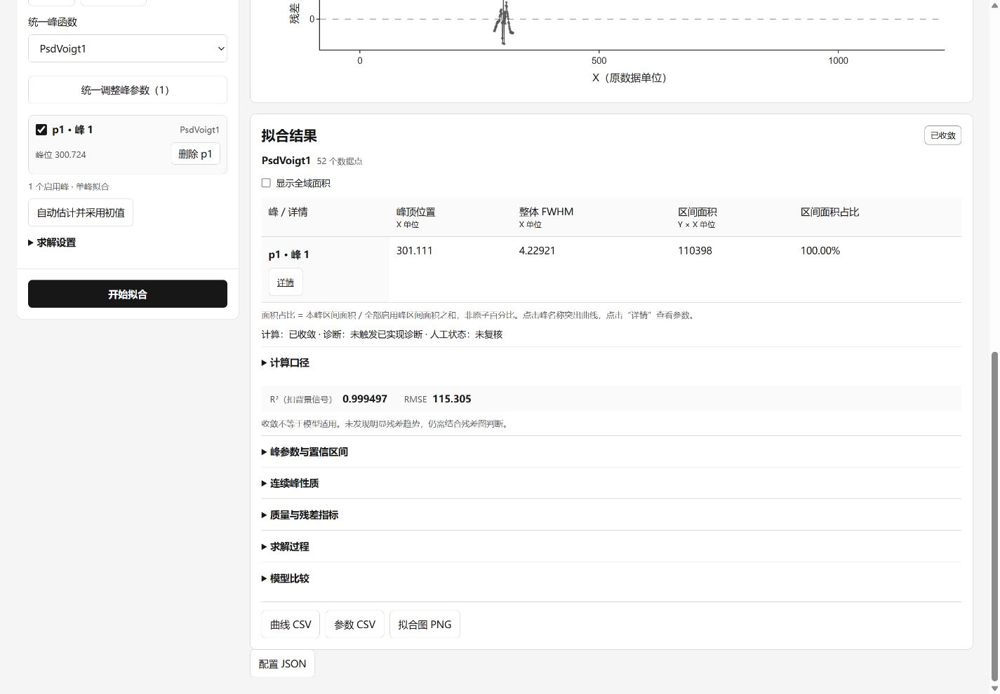

**图 3｜模型、状态和导出入口。** 左侧选择峰形并编辑初值，右上查看谱线和残差，右下读取收敛状态、峰性质并导出。Raman 界面当前使用通用 X/Y 单位标识；本数据的 X 单位由原表确定为 cm⁻¹。

### 第四步：对照结果和残差

下面将同一次复算的拟合区间单独放大。上图保留所有区间内观测点，下图为观测值减总拟合；曲线连接模型在原采样点处的计算值，没有补造观测点。

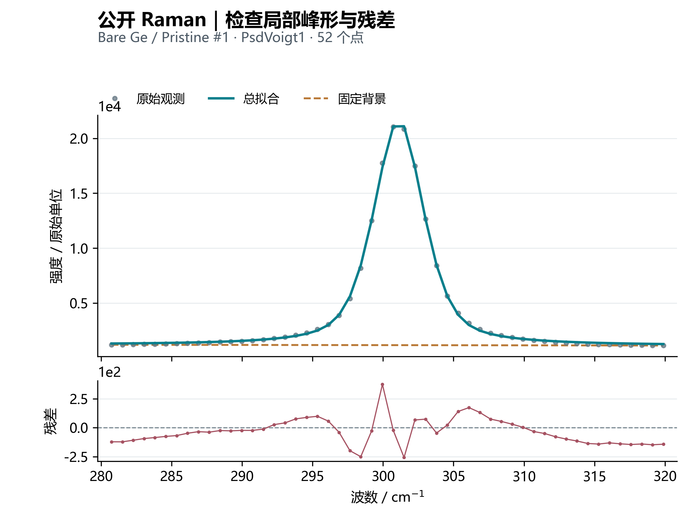

**图 4｜局部峰形与残差。** 单条 `Pristine #1` 光谱，n=52 个谱点，不是 52 次独立实验。直线背景固定，PsdVoigt1 参数自由优化；未对原谱平滑、归一化或平均。没有绘制重复测量误差条。

| 复算项目 | 本例结果（约值） | 含义 |
| --- | --- | --- |
| 峰顶 xc | 301.11090 cm⁻¹ | 本模型的实际峰顶 |
| 整体 FWHM | 4.22921 cm⁻¹ | 当前背景和峰形下的半高全宽 |
| 全域面积 A | 115277.39 | 原始强度单位 × cm⁻¹；含区间外外推 |
| Lorentzian 比例 μ | 0.616777 | 峰形混合参数 |
| R² | 0.999497 | 高 R² 仍不能替代残差检查 |
| RMSE | 115.305 | 原始强度单位 |

这些数值仅用于核对操作路径，不是对整批样品的统计结论。导出“曲线 CSV”“参数 CSV”和“拟合图 PNG”；设置改变后须重新拟合。数值来源和完整精度见 [raman-result.json](../examples/public/results/raman-result.json)。

如需已知参数的练习，可继续使用[合成示例说明](../examples/README.md)中的 Gaussian 数据；它作为补充练习，不替代本实谱教程。

## 导入自己的数据

### 文件准备

支持 CSV、TXT、TSV、DAT、XY、XYE、XLS、XLSX、XLSM，单文件不超过 25 MiB。文本优先使用 UTF-8；读取器也尝试 GB18030，并自动推断分隔符。简单格式如下：

```csv
x,intensity
100,15.2
101,17.1
102,23.4
```

这三行只展示格式；单峰拟合区间至少需要四个有效点，实际谱线应有足够密集的采样。读取器支持无表头数值文本，以及以 `#`、`;`、`//` 开头的注释行。仪器二进制文件不能通过改后缀获得支持，应先在仪器软件中导出文本或表格。

Excel 可以选择工作表；表头应放在首行。导入后在弹窗浏览全部工作表与数据列，区分原谱、统计值和误差列。建议 X/Y 仅是草稿，必须点击“应用到图表”；之后可在“查看全部数据 / 更改列”重新选择。应用将所选列转换为数值，排除非有限值和无效配对行，然后按 X 升序排序。检查显示的点数和谱形是否符合预期。

更改列时，选择区是待应用草稿，顶部摘要和曲线仍表示当前数据；点击“取消”可恢复已应用选择。点击“应用到图表”并读取成功后，如存在已编辑工作会提示替换影响；确认后摘要、曲线、来源及单谱状态一起更新。取消、读取失败和过期请求均不能覆盖当前分析。预览失败会保留原数据并显示错误；更换文件读取失败也会保留原文件，并明确提示当前仍使用的文件名。顶部同时列出有效 XY 点数与工作表总行数，避免混淆。

### 坐标和数据质量

- Raman：X 使用实际波数；XRD：X 使用以度为单位的 2θ；XPS：X 使用结合能 eV。应用不转换单位。
- X 和 Y 必须是不同列。拟合区间内重复 X 会触发错误；请依据采集方式在外部处理重复测量。
- XYE 的第三列不会自动成为测量误差权重；当前工作流使用所选 X/Y。
- 不自动裁剪原始负强度，也不把残差负值归零。

“查看全部数据 / 更改列”弹窗显示全部解析数据，每页 100 行，可上一页、下一页或输入页码跳转。所有解析后的列均可查看，包括文本和未选为 X/Y 的列；X/Y 列用底色和标签标记。表头固定，宽表仅在表格内横向滚动。关闭、取消或 Esc 返回原入口并保留当前谱线；只有“应用到图表”才提交列选择。

解析器会移除全空行／列，浏览表不再执行 X/Y 有效性筛选或排序。解析行号不含表头，不等同于文本文件的物理行号；缺失值显示“—”，非有限值显示 Infinity / -Infinity。会话恢复后的“查看会话原谱”仅显示已保存的 X/Y 快照，其他工作表和列需重新导入原文件。

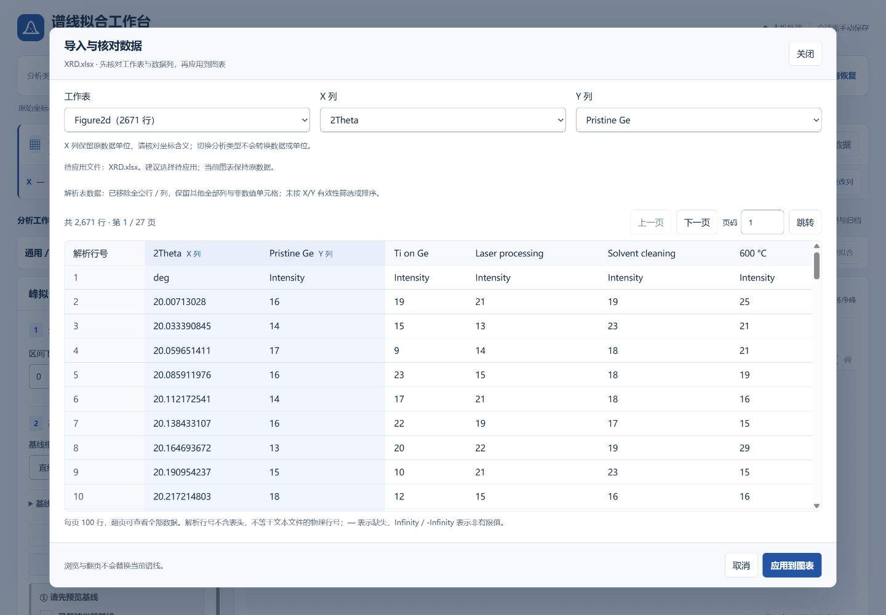

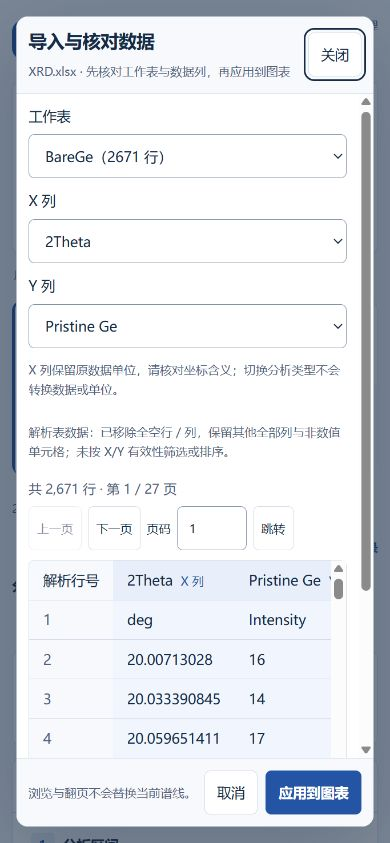

上传数据存放在本机后端内存中。用于换列预览的数据登记会在创建约一小时后被后续请求清理；出现“数据已失效”时重新导入。刷新页面或停止服务前，请在顶部“本地会话 · 保存与恢复”下载会话 JSON，并保留原始文件。已保存的原谱快照不依赖服务内存数据集，恢复后如需更改列仍需重新导入原文件。

### 查看数据清理记录

应用数据列后，数据栏下方显示有效配对数、排除行数、是否稳定排序以及重复 X 数。“查看清理与行号记录”列出 X/Y 空值、非数值、无穷值及最多 200 行明细。原因按 X/Y 分别计数，同一行可能对应多项原因，因此原因次数不一定等于排除行数。

解析行号不含表头，也不是原文本的物理行号；汇总基数为既有解析流程移除全空行后的工作表。排序后每个观测点的解析行号映射保存在会话审计中。重复 X 保留，程序不会自动平均、插值或修补。旧服务未返回可选 `audit` 时明确显示“未提供”，不会假定零排除。

## 单峰与 XRD 操作

### 选择模式和区间

右上角“分析类型”提供“通用谱线”“XRD 峰拟合”和“XPS 峰拟合”，选中后会显示用途或 X 轴要求。分析当前一条谱线时选择“单谱拟合”；单谱工作区支持手动添加一个或多个峰。

通用谱线和 XRD 峰拟合共用已应用数据，各自保留单谱配置与结果；XRD 以 2θ（°）标识横轴、峰位和 FWHM，不执行数据转换、晶相鉴定或晶粒尺寸计算。

在左侧输入区间起点和终点，或使用“框选分析区间”。点击“调整范围”后，可以拖动两侧边界，也可以通过上方箭头整体平移；点击“完成调整”或按 Esc 收起手柄。点击图中的起点、终点圆点可定位对应输入框。选择区间时保留足够背景，避免把相邻峰误纳入单峰解释。

### 公开 XRD 示例

导入 [XRD.xlsx](../examples/public/zenodo_18845748/XRD.xlsx)，选择 **BareGe → 2Theta → Pristine Ge**，点击“应用到图表”，再选择“XRD 峰拟合”。注意这里的 `BareGe` **没有空格**。将区间设为 **65.8～66.6°**，使用无手动锚点的默认直线背景，预览并复核基线，选择 PsdVoigt1，手动添加一个峰，采用自动初值后拟合。

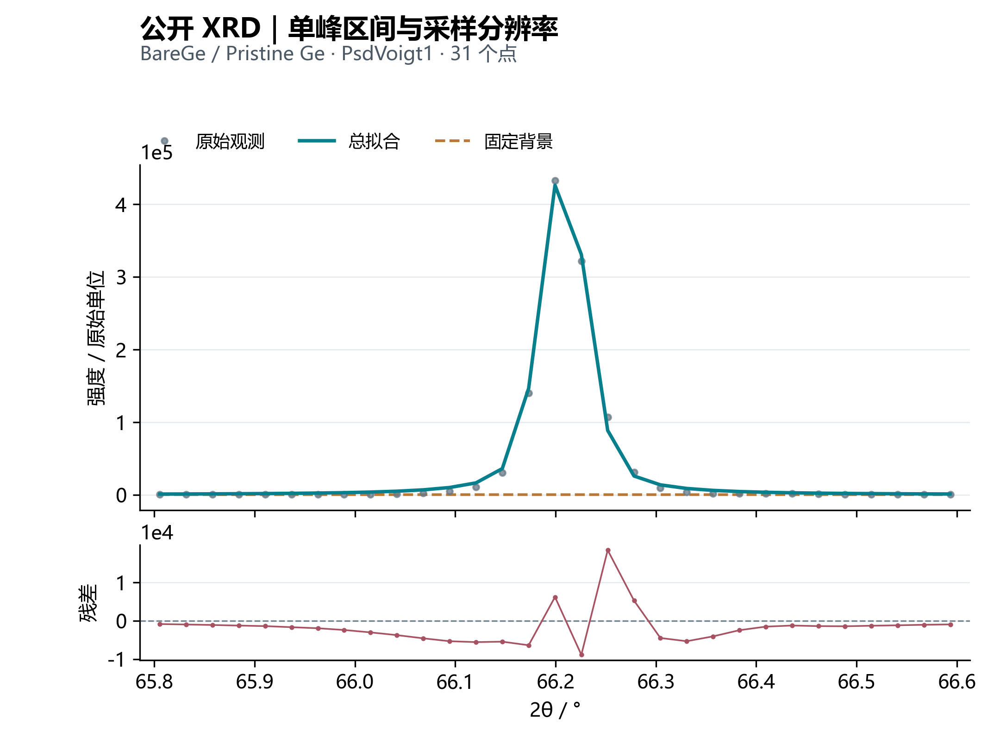

**图 5｜XRD 单峰操作与采样限制。** 一条原谱的局部区间，n=31 个谱点；未做平滑、归一化或仪器展宽校正。复算峰顶约 **66.20816°**、FWHM 约 **0.05184°**、R² 约 **0.997326**。原谱步长约 0.02626°，一个 FWHM 只有约两个采样间隔，峰宽对模型和采样较敏感；不要把小数位数等同于测量精度，也不要直接用此宽度推断晶粒尺寸。线段连接模型采样值，尖锐外观不表示新增了实验点。

完整设置和输出见 [xrd-result.json](../examples/public/results/xrd-result.json)。

### 设定基线

基线先由锚点确定，拟合过程中固定；峰参数优化不会同时重新估计基线。

| 类型 | 输入要求 | 当前实现 |
| --- | --- | --- |
| 无基线 | 无锚点 | 基线恒为零，适合已完成背景校正的数据 |
| 常数 | 至少一个有效锚点 | 使用锚点 Y 的平均值 |
| 直线 | 至少两个不同 X 的锚点 | 连接最左和最右锚点；额外内部锚点不改变直线 |
| 多项式 | d 阶需要至少 d+1 个不同 X 的锚点，d 为 1～8 | 对锚点拟合多项式 |
| Spline | 至少三个不同 X 的锚点 | 三次插值样条；锚点覆盖范围外保持端点值 |
| B-Spline | 至少四个不同 X 的锚点，平滑强度非负 | 平滑样条；覆盖范围外保持端点值 |

展开“基线设置说明”并编辑锚点，将锚点放在有依据的背景位置，核对图中编号和输入坐标；重复 X 不计为独立约束，后端会拒绝重复锚点。使用建议锚点后同样需要预览并勾选“已复核当前基线”。“预览基线”用于检查当前配置计算的基线，并不证明背景选择正确。

未提供手动锚点时，界面允许的默认直线流程可使用区间端点估计。端点若仍有明显峰尾，应调整区间或手动指定锚点。提高多项式阶数不保证更可靠，过于灵活的基线可能吸收真实峰信号。

### 初值、约束与求解

选择峰模型后，可用“自动估计并采用初值”估计参数。自动分析只提供候选和起点，不是最终拟合，也不自动确认峰的物理来源。

侧栏显示参数摘要；点击“统一调整峰参数”，在弹窗中查看完整数值并填写初值、下限、上限。摘要仅缩短显示，不改变实际参数精度。上下限留空时使用模型边界；“固定”表示该参数不参与优化。初值必须位于允许范围内，宽度必须满足模型要求。

全部峰表将标签、启用、参数初值、上下限和固定开关并列显示；窄屏可在表格内横向滚动，内容较多时在弹窗内纵向滚动，底部操作保持可见。XPS 参数按峰打开。修改即时生效，“完成”“关闭”或 Esc 均保留修改；关闭后返回设置，点击“开始拟合”才会执行求解。

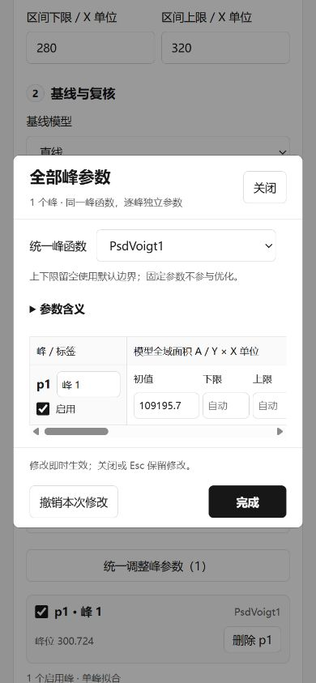

弹窗中的数值是求解起点，拟合完成后不会自动替换为最优参数。最终数值请到“拟合结果”中读取。初值估计会更新当前峰形的初值，但不会清除已设置的上下限或固定开关；重新估计后应核对两者是否兼容。

展开“求解设置”，默认勾选“固定峰中心预拟合，再释放中心”。展开“求解参数”可查看中心固定阶段上限（20 次函数评估）、最大函数评估次数（2000）和收敛阈值（`1e-8`）。求值次数并非实验重复次数；遇到失败，先检查数据、基线、峰形和约束，再决定是否增加上限。

改变区间、基线或参数后，旧结果可保留用于对照，但会标记“已过期”并禁用导出；重新拟合后才能导出当前结果。

## 峰形与参数口径

统一术语：`A` 为**模型全域积分面积**，`xc` 为**实际峰顶位置**，FWHM 为**半高全宽**，HWHM 为**半高半宽**，`mu`（μ）为 Lorentzian 混合比例。面积单位为 Y 单位乘 X 单位，净峰高使用 Y 单位，宽度和峰位使用 X 单位。

| 模型 | 主要参数 | 宽度解释 |
| --- | --- | --- |
| Gaussian | A、xc、w | w 是整体 FWHM |
| Lorentz | A、xc、w | w 是整体 FWHM |
| PsdVoigt1 | A、xc、w、mu | Gaussian 和 Lorentz 分量共用 w，w 是整体 FWHM |
| PsdVoigt2 | A、xc、wG、wL、mu | wG、wL 是两个分量各自的 FWHM；整体 FWHM 另行计算 |
| Split Pseudo-Voigt | A、xc、h_low、h_high、mu | 两侧 HWHM 不同，整体 FWHM = h_low + h_high |
| EMG（高 X / 低 X 拖尾） | A、xc、sigma、tau | sigma 是高斯核标准差，tau 是指数尾尺度，两者均不等于整体 FWHM |

EMG 在 `tau=0` 时退化为 Gaussian。拖尾方向按 X 数值增减定义，XPS 倒序横轴不改变这个定义。本项目的 Split Pseudo-Voigt 归一化和 EMG 峰顶重定位有具体实现，不能直接套用其他软件同名模型的参数。

“连续模型峰性质”从连续函数计算整体 FWHM、两侧半宽、净峰高、全域面积、当前区间模型面积和区间覆盖比例。区间积分使用实际参与拟合的数据端点与解析原函数/CDF；全域面积包含区间之外的模型外推。半高交点超出数据范围时会提示，不能将其当作已充分测量的峰宽。

旧字段 `derived_parameters.area_in_range` 使用采样点梯形积分；新字段 `peak_geometry.area_in_range` 使用模型积分。两者不能混为同一数值口径。无有效宽度时返回空值和原因；派生峰性质暂不报告标准误或置信区间。

## XPS 多峰操作

### 一次完整分析

1. 导入结合能和强度数据，在“更改列”中选择对应列，再切换到“XPS 峰拟合”。横轴从高能向低能显示。
2. 输入区间下限和上限，或在图中框选。“拖动区间”改变分析范围，“平移视图”只改变可见视图。
3. 选择无背景、直线或静态 Shirley。可手填低/高能端水平，也可留空采用相应端点窗口的中位数。区间变化后按需点击“窗口重置到区间两端”。
4. 点击“预览背景”。使用 Shirley 时，检查后勾选“已复核当前 Shirley 背景”，才能拟合。
5. 点击“添加单峰”，或“检测候选峰”后逐个选择。点击各峰“参数”打开编辑弹窗，调整标签、峰形、初值、上下限和固定参数；“参数含义”可展开查看，并可撤销本次打开以来的修改。候选只提供初值；后续预览不会覆盖人工初值。
6. 有独立依据时设置峰组关系，然后点击“开始拟合”。图中分量为净峰，总拟合只叠加一次背景。
7. 检查各分量、总拟合、残差和参数状态，保存结果与配置。改变设置后重新拟合再导出。

### 公开 XPS 示例：恢复配置、检查背景和诊断

1. 导入 [XPS.xlsx](../examples/public/zenodo_18845748/XPS.xlsx)，选择 **Ge2p → Binding Energy (E) → Pristine Ge #1**，点击“应用到图表”，切换“XPS 峰拟合”。
2. 点击“加载配置 JSON”，选择仓库内的 [xps-ge2p-configuration.json](../examples/public/xps-ge2p-configuration.json)。该文件含原文件 SHA-256 和原始数组，已在当前界面验证能匹配原谱。
3. 核对区间 **1208～1260 eV**、偏移 **0 eV**、背景 **静态 Shirley**。低能端水平为 **137693**、高能端水平为 **260451**，本例使用明确数值而非自动端点窗口。
4. 点击“预览背景”，复核后勾选“已复核当前 Shirley 背景”。配置载入不会跳过这个步骤。
5. 点击“开始拟合”，检查四个探索分量、总谱和残差。

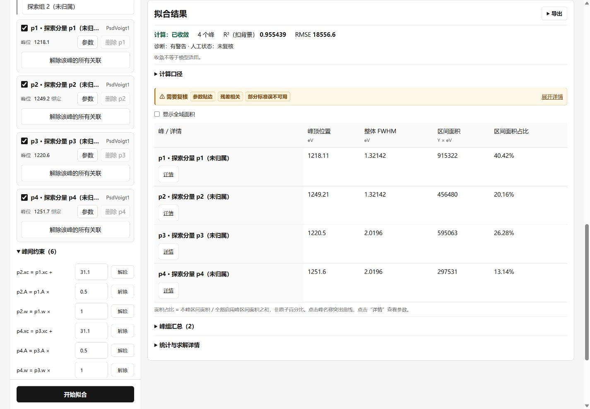

**图 6｜XPS 拟合结果与诊断。** 图中使用公开 `Ge2p / Pristine Ge #1` 原谱，已恢复配置、预览并复核 Shirley 背景后拟合。四个分量仅作探索性分解，未命名为任何化学态。

| 初始参数 | p1 | p2 | p3 | p4 |
| --- | --- | --- | --- | --- |
| A（原始强度 × eV） | 893144.91 | 426718.61 | 585485.63 | 313086.72 |
| xc / eV | 1218.1 | 1249.2 | 1220.6 | 1251.7 |
| w / eV | 1.3 | 1.3 | 1.8 | 1.8 |
| μ | 0.35 | 0.35 | 0.35 | 0.35 |

各峰中心边界为初值 ±1.5 eV，宽度边界 0.15～6 eV。p2 绑定 p1，p4 绑定 p3：中心偏移 31.1 eV、面积比 0.5、宽度比 1；被绑定参数的输入初值随后由关系展开决定。这些是本教学配置的约束，不是已验证的化学态先验，也不能直接照搬到其他数据。

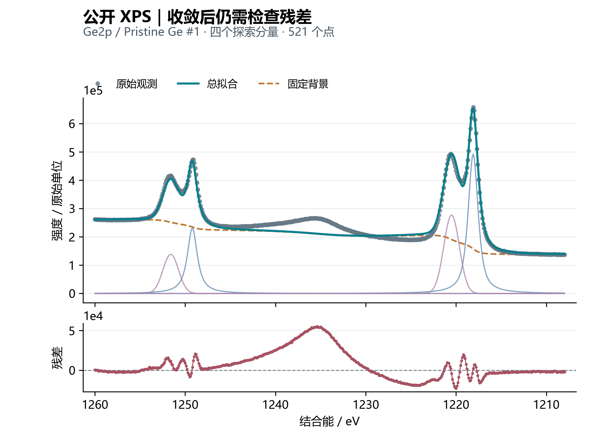

**图 7｜为什么“已收敛”还不够。** n=521 个谱点，四个 PsdVoigt1 净峰与固定 Shirley 背景联合显示；蓝色细线为第一组两个净峰，紫色细线为第二组两个净峰，总拟合仅加一次背景。没有进行归一化、位置间平均或平滑。1235 eV 左右仍有显著宽残差，不应当作随机噪声忽略。

**图 8｜保留不理想结果，演示如何复核。** 截图展示当前结果区的质量指标和警告，逐峰参数通过峰名直接查看。 本例 R² 约 **0.955439**，但 Durbin–Watson 仅约 **0.00856**；`p3.mu` 和 `p4.mu` 贴边，相关标准误不可用。数值满秩、优化收敛与模型适用性是不同判断。本例用于教学配置恢复和诊断，**不能用于确认化学态或可靠组分定量**。完整结果见 [xps-result.json](../examples/public/results/xps-result.json)。

### 峰组和约束

“添加双峰组（同宽）”使用你给出的峰间距与第二峰/第一峰面积比，不预设元素。可创建峰位偏移、面积比例和宽度比例关系：

```text
目标峰.xc = 来源峰.xc + 偏移值
目标峰.A  = 来源峰.A  × 面积比例
目标峰.w  = 来源峰.w  × 宽度比例
```

同类宽度关联支持 `w↔w`、`h_low↔h_low`、`h_high↔h_high`、`sigma↔sigma`；`tau` 可设初值、边界或固定值。被绑定参数通过独立根参数展开，子参数边界会传播到根参数。约束冲突、循环关联或停用被引用的来源峰会阻止有效求解。

删除被关联峰前，先点击“解除该峰的所有关联”；切换峰形遇到不兼容关系时，也应先解除冲突。增加峰数会增加参数，并不自动增加解释可信度。

### 能量校准与 Shirley 的含义

能量偏移采用 `E_corrected = E_raw + shift_eV`，同步平移区间、端点窗口和峰位。填写“校准依据”；应用不会自动判断荷电校正。

静态 Shirley 在能量升序上迭代：

```text
B(E) = B_low + (B_high − B_low) × ∫low^E(y − B)dE / ∫low^high(y − B)dE
```

积分使用真实采样步长。背景计算后固定，不随峰参数优化更新。净积分非正或背景不收敛会报错，不自动回退到其他背景模型。参数误差也不包括背景选择或校准的不确定性。

## 读懂结果

### 科研图表样式

交互图采用 nature-figure 的字体、留白和视觉层次原则：白底，左侧与底部细坐标轴，刻度向外，默认关闭网格。使用 Arial / Helvetica，并依次回退到可用的 Noto Sans CJK SC、微软雅黑、苹方和系统无衬线字体。

| 文字用途 | 网页字号 |
| --- | --- |
| 坐标轴标题 | 15 px |
| 坐标刻度、图例、悬停信息 | 13 px |
| 峰中心、基线锚点等辅助标注 | 12 px |

主图与残差使用相同左右边距，残差面板高度为 180 px。无边框图例位于主图上方，工具栏独占一行；窄屏时增加主图高度与图例留白，并降低单峰横轴刻度密度，避免文字遮挡。窗口恢复宽屏后自动还原布局。以上为网页显示规格，论文插图应按最终印刷尺寸另行检查字号。

原始数据为灰色散点，总拟合为蓝色实线，固定背景为灰色虚线；XPS 净分量采用按峰标识固定的颜色和线型，删除或重排其他峰不会改变该峰样式。单峰、XRD 和 XPS 的残差均采用灰色点线图：细直线按采样顺序连接相邻点，不做平滑或插值，缺失值处断开；虚线标明零参考值。端点仍可点击定位输入框，数值标签通过悬停查看，避免遮挡曲线。

图表外观可参照上方界面总览和 Raman 拟合截图。曲线连接原采样位置的计算值，不增加观测点；显示小数位数不代表测量精度。工具栏及结果区的 PNG 按钮只导出主图，不包含残差和结果表；完整归档应同时保存曲线与参数 CSV。

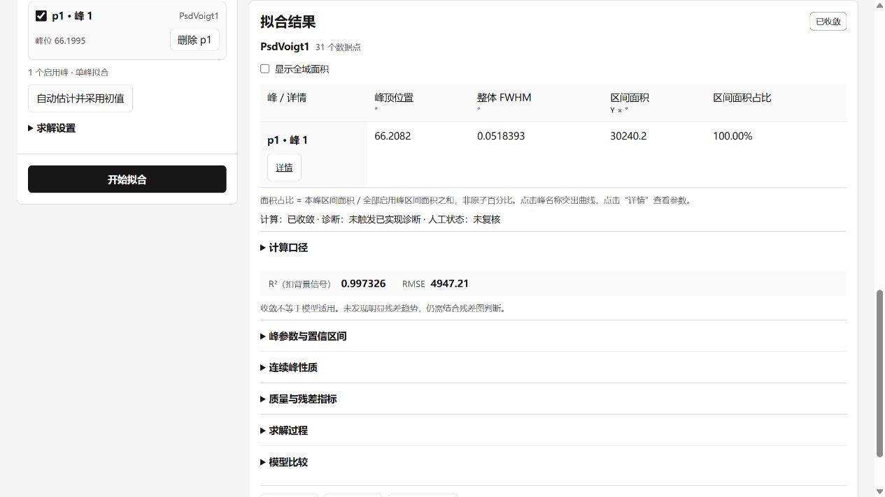

**图表字体与残差点线样式。** 图中为公开 XRD 数据的 31 个谱点，采用 PsdVoigt1，与本手册的 XRD 复算设置一致。独立科研插图保留散点残差。连线仅帮助观察相邻采样点的变化，不代表连续测量或新拟合模型。

### 数值与诊断

先判断优化是否收敛，再检查参数是否可辨识，最后结合实验依据判断模型是否适用。这三个问题不能用一个 R² 代替。

单峰、多峰、XPS 和批量使用同一峰结果表，默认展示峰顶位置、整体 FWHM、当前区间模型面积及其占比；全域面积可勾选显示，也可在详情中查看。摘要另列 R²（扣背景信号）和 RMSE。峰顶与整体宽度取自连续模型计算结果，不能用分量宽度代替；旧结果缺少这些字段时显示“—”，需重新拟合。全域面积包含模型在拟合区间外的外推部分，区间面积只覆盖实际拟合端点。

结果位于画布下方。点击峰名称同时突出曲线并打开只读参数与连续峰性质弹窗，不再设置独立“详情”按钮；批量同样直接打开，无需再展开第二张峰表。“查看结果”将焦点移到结果区；计算完成提示不会自动抢走当前焦点。

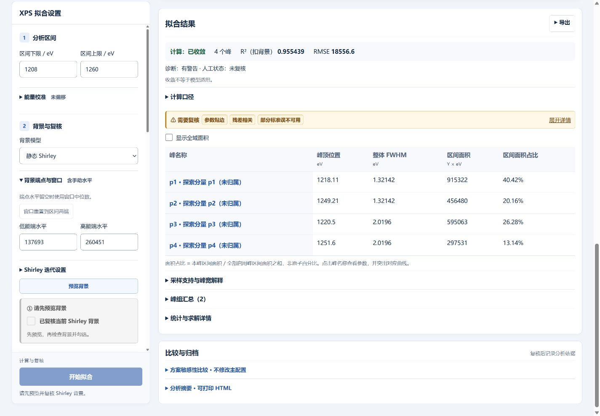

默认收起“峰参数与置信区间”“连续峰性质”“质量与残差指标”“求解过程”和“模型比较”。点击相应标题查看完整内容；求解器原始消息和分阶段记录位于“求解过程”。收敛状态与模型适用性分开提示，峰性质警告、初值及不确定性警告仍直接显示。结果内容随页面滚动，底部集中曲线、参数、图片和配置导出；逐峰详情使用模态弹窗。拟合期间或设置改变后禁用导出，重新拟合完成后恢复。

计算状态（进行中／已收敛／未收敛／固定参数计算）、诊断状态和人工复核状态分别显示。全部参数固定时不声称优化收敛；“未触发已实现诊断”不等于科学验证通过。贴边、强相关、残差相关和外推警告持续可见，人工接受不会清除警告。批量计数“已完成计算”也不代表全部合格。

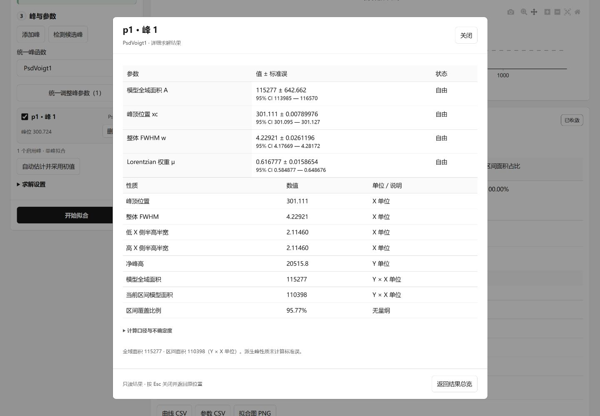

| 指标或提示 | 解释与操作 |
| --- | --- |
| R²、调整 R² | 描述当前模型对数据变异的解释程度；不能据此确认物理机制 |
| RMSE、SSE/RSS | 残差尺度与残差平方和；比较时保持同一数据和预处理 |
| 残差方差估计 | 无权重的残差平方和/自由度，单位为强度²，不是已按测量误差标准化的 χ² |
| 残差趋势、Durbin–Watson、异常点 | 诊断线索；仍需观察结构性偏离、局部肩峰和背景错误 |
| AICc、BIC | 在可比的数据、区间、背景和权重条件下比较模型；AICc 点数不足时为空 |
| 参数贴边、秩不足、标准误为空 | 查看原因并复核约束或模型；空值不是零误差 |
| 区间覆盖比例不足、半高点超界 | 提示外推对面积/宽度的影响；按实验条件扩大测量或分析范围 |

模型比较默认比较四种对称单峰；勾选“加入非对称模型”后扩展为七种。推荐结果不会自动替换当前选择；需要自行选择模型并重新拟合。

XPS 的 R² 使用扣背景信号。EMG 自由尾尺度很小（`tau/sigma < 1e-3`）时会提示弱尾，不报告不适用的线性标准误；`tau` 固定为零时，可辨识的 Gaussian 宽度仍可估计误差。标准误和置信区间都依赖当前模型、约束和固定背景。

XPS 面积占比使用当前能区内启用分量的积分面积总和作分母，**不是元素原子百分比**。当前不支持 Tougaard、多重态专用模型、自动化学态归属、RSF 定量、测量误差加权和批量联合拟合。

### 采样支持与方案敏感性

结果区展开“采样支持与峰宽解释”，查看半高区间内的**实际观测点数**及相邻正间隔的最小值、中位数、最大值；非均匀采样按实际坐标计算。没有有效半高区间或不足两个局部观测点时，相关间隔显示缺失和原因。半高点超出观测范围会提示模型外推，不设未经验证的统一“合格点数”阈值。

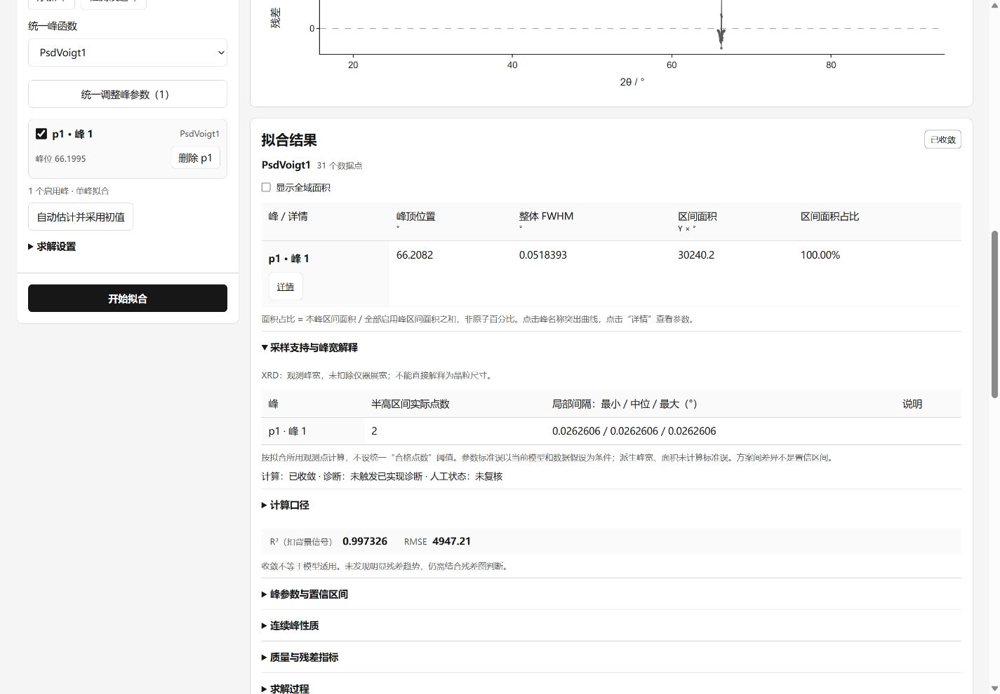

公开 XRD 演示中半高区间内实际有 2 个点，间隔约 0.0262606°；这与模型给出的连续 FWHM 是不同信息。观测峰宽未扣除仪器展宽，不能据此直接推断晶粒尺寸。

在工作区底部展开“方案敏感性比较 · 不修改主配置”：

1. 点击“保存当前拟合为主方案”，冻结当前结果及其配置。
2. 修改替代方案的区间、背景或自由参数初值；固定值和绑定约束保持。
3. 预览方案背景并勾选“已检查此方案区间与背景”，再单独计算。
4. 表格比较峰顶、FWHM、区间面积和全域面积，展开诊断查看警告。失败方案保留原因；主工作区变化后明确标记旧配置。

最多保留 8 个替代方案；重新保存主方案会清空旧比较。临时比较不进入本地会话，可用比较面板下方的 HTML 摘要归档。主配置与结果不会被替代方案覆盖。不同背景或观测点集的 AICc/BIC 不自动排名，方案差异不能当作置信区间或完整系统误差。

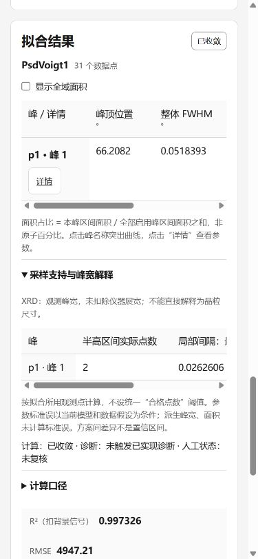

## 导出与恢复

### 输出内容

| 文件 | 用途 |
| --- | --- |
| 单峰曲线 CSV | `x, raw_y, baseline, net_y, peak_y, total_y, residual` |
| 单峰参数 CSV | 参数、误差、边界、固定状态、拟合设置、统计量及 `geometry.*` 峰性质 |
| XPS 曲线 CSV | 原始/校准能量、原始强度、背景、分量、净峰总和、总拟合、残差 |
| XPS 参数 CSV | 分量参数、约束相关状态、统计量和峰性质 |
| XPS 配置 JSON | 保存当前源信息、数组与分析配置，供严格匹配后重新拟合 |
| PNG | 导出当前拟合谱图，用于展示；不代替数值结果归档 |

建议把原始文件、参数 CSV、曲线 CSV、PNG 和 XPS 配置保存在同一分析目录，并记录样品、采集条件、单位、校准依据、软件提交版本和分析日期。通用／XRD 也支持配置 JSON，单峰配置保留求解设置；配置和 CSV/PNG 都不等于可恢复的完整会话。

### 恢复 XPS 配置

1. 重新导入**原始文件**，选择原工作表和原 X/Y 列。
2. 切换 XPS，点击“加载配置 JSON”。支持配置导出文件，也支持含 `configuration` 的 XPS 拟合结果 JSON。
3. 应用严格核对文件 SHA-256、工作表、谱列和原始数组。Excel 即使数值未变，重新保存后文件字节也可能变化，导致校验失败。
4. 载入后复核背景，必要时重新勾选 Shirley 复核，再执行拟合。文件中的旧结果不会被直接当作当前可信结果。

旧峰形和旧参数配置使用版本 1；包含新峰形或新参数时使用版本 2。当前支持版本 1/2，内外版本必须一致。不要手改版本号绕过校验。

切换分析类型保留各自状态，确认应用新谱会重置各类型单谱设置。刷新页面不会自动恢复会话。结果失效时原有 CSV／PNG／配置导出被禁用；XPS 的原有导出接口会依据完整配置重新求解。新增本地会话和 HTML 分析摘要可归档旧结果并保留失效标记，不重新求解。

### 工作保护与撤销

参数修改即时生效；“撤销本次修改”恢复本次打开参数弹窗时的快照，包含标签、启用、峰函数、参数和相关约束。关闭后再次打开会建立新快照。应用另一份数据后旧快照失效，不能跨数据恢复；修改或撤销后应重新拟合。

应用新数据、载入替换配置、更换已有批次模板或清空已有批次结果时，会说明影响并请求确认，默认聚焦“取消，保留当前工作”。取消或 Esc 保留原工作；确认清空批次结果会保留已导入谱线，便于重新预检。

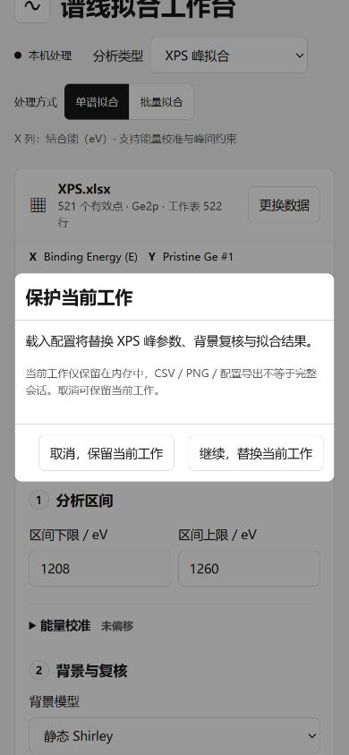

有当前工作时，刷新或关闭页面会请求浏览器显示离开提醒；浏览器可能限制提示是否出现及其文字。**这不是自动保存**，确认离开后当前会话仍会丢失。CSV、PNG、配置 JSON 和批次追溯 JSON 均不代表完整会话可恢复；请使用顶部独立的“保存当前会话 JSON”下载可恢复会话；没有自动保存。

### 本地会话 JSON（独立版本 1）

顶部“本地会话 · 保存与恢复”提供“保存当前会话 JSON”和“载入本地会话”。先完成或暂停正在进行的操作，再保存**当前选中的单谱或批次**；其他分析页不一并归档。批次必须先纳入所选谱线并完成全部有效预检。未纳入草稿、候选峰状态、方案比较临时编辑与 HTML 用户备注不属于会话。

会话文件保存原始 X/Y 快照、文件哈希及谱列身份、当前配置、各结果对应的配置、失效标记、单峰求解设置、数据审计，以及批次顺序、尝试／父来源、诊断、人工接受和样品条件记录。格式标识为 `spectral-fit-session`、`session_version: 1`，与批次追溯 v2 分开；旧追溯文件不能在此恢复。

载入先完整检查结构、容量、原谱与结果观测的一致性以及继承引用，再说明影响并确认覆盖。错误或不支持的文件不会部分替换当前工作。单谱数据是应用级共享数据，因此载入单谱会重置其他类型的单谱工作区；各类型批次独立。取消覆盖保留原工作。

服务重启后仍可载入查看结果，不需要原有 `dataset_id`。恢复不会自动拟合，旧背景复核不用于新的计算：单谱先重新预览并复核；批次点击“重新预览恢复背景”，逐条或全部复核后显式继续。已完成结果、人工接受和警告保留；中断尝试标为失效，未完成谱线等待新的求解。顺序拟合从最后有效且获准的父结果重建继承，跳过或重跑会断开相应旧链。

缺少原谱快照时先显示只读结果，当前工作区不替换。点击“匹配缺失的原文件”，按 SHA-256、工作表、X/Y 列匹配，再逐点核对观测值；全部补齐后才能确认恢复计算。只读结果也可导出分析摘要。

限制：100 MiB、100 条谱、累计 200,000 个原谱点；另有结构安全上限（400 万节点、深度 32、单行 100 次尝试）。超限拒绝，不截断。无自动保存、数据库或后台续算，请保管下载文件及原始实验文件。

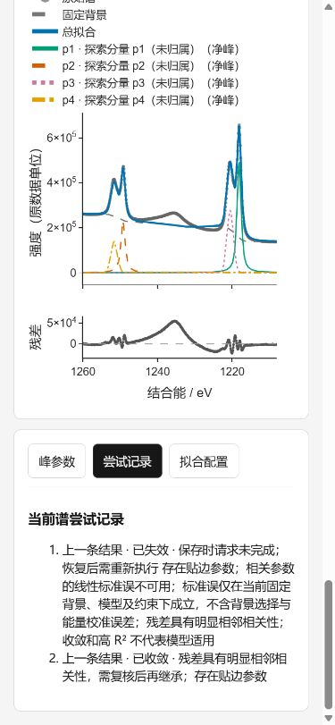

### 可打印 HTML 分析摘要

单谱、批次与方案比较面板均可展开“分析摘要 · 可打印 HTML”，填写用户备注后导出。HTML 直接引用已保存结果，不调用求解器；备注单列为非软件计算结论，文件名、标签与备注均按文本转义。失效结果标记为旧配置。

摘要包含原文件哈希与谱列、单位、区间、背景、模型、参数／约束、求解设置、指标、警告、人工决定、曲线及采样支持。浏览器打开后可打印或另存 PDF。参数置信区间仍是条件不确定度；不自动作出材料机理、化学态或晶粒尺寸结论。

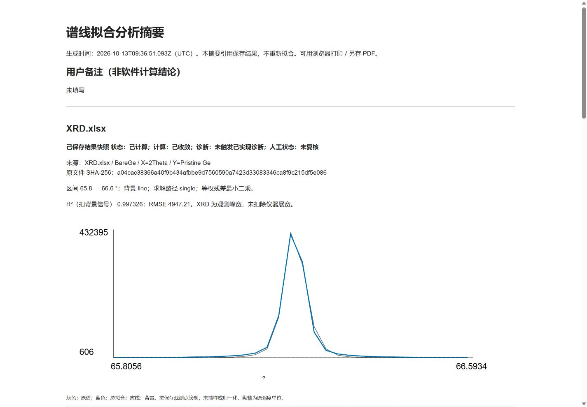

误差加权、仪器展宽校正、RSF 定量、新背景模型等仍需独立规格和科学验证，不在本阶段增加；XYE 第三列不自动作为已认可的误差模型。

## 常见问题

| 现象 | 排查方法 |
| --- | --- |
| 未找到 Python 或 NumPy 安装失败 | 检查是否为 Python 3.10～3.12；更换解释器后须为项目重新创建兼容环境 |
| 无法运行 npm.ps1 | PowerShell 中使用 `npm.cmd`；一键脚本已使用此入口 |
| 端口 5175/5176 被占用 | 回到之前的启动窗口停止旧服务；不要结束来源不明的进程 |
| 页面打开但导入/拟合失败 | 检查后端窗口、`.logs/backend-error.log`，确认后端监听 5176 |
| “数据已失效”或刷新后空白 | 载入已保存的本地会话；没有会话文件时重新导入原文件，配置 JSON 仅恢复设置 |
| 找不到数值列或 X/Y 相同 | 检查表头、分隔符、所选工作表与列；先在表格软件确认内容 |
| 重复 X、锚点重复或点数不足 | 调整区间，检查数据与锚点；满足当前模型所需的有效独立信息 |
| 拟合按钮不可用 | 先显示数据；XPS 需启用至少一个峰，Shirley 需预览并复核；检查界面错误提示 |
| Shirley 净积分非正或不收敛 | 检查区间、端点窗口和端点水平，确认背景选择有依据 |
| 参数贴边、误差为空、曲线局部偏离 | 复核初值、边界、背景和峰数，不仅增加求值次数 |
| 配置与原谱不匹配 | 使用原始字节一致的文件、原工作表和原谱列；不能仅凭文件名相同判断 |
| 导出按钮变灰 | 等待本次计算完成；若结果已过期，重新拟合当前配置 |
| 参数显示不全 | 通用／XRD 点击“统一调整峰参数”，XPS 点击“参数”；窄屏在弹窗内滚动 |
| 关闭弹窗后数值仍已改变 | 修改即时生效，Esc 不撤销；关闭前可点“撤销本次修改”回到本次打开时的值，再拟合 |
| 侧栏数值与结果不同 | 侧栏是初值摘要，结果面板是优化后的参数；摘要缩短显示不改变精度 |
| 旧 PsdVoigt2 结果没有整体 FWHM | 用当前版本重新拟合；wG/wL 不是整体 FWHM |

## 复现与实现依据

核心单元测试和前端构建命令见根目录 README。测试可检查数值实现、约束和交互回归，不能为未知实谱提供化学态或参数真值。

公开原谱已收入 `examples/public/zenodo_18845748/`。本次手册的复算脚本不依赖历史分析目录，在项目根目录运行：

```powershell
.\.venv\Scripts\python.exe examples/public/reproduce.py
```

脚本核对原文件后，重新生成 `examples/public/results/` 中的三类拟合结果、曲线 CSV、参数 CSV 和汇总。它会覆盖这些派生结果，不改变原文件。可选绘图命令、字体要求、来源署名和处理范围见[公开数据复现说明](../examples/public/README.md)。

旧的 `backend/tests/validate_*_real.py` 等历史回放仍依赖 `data/analysis/` 的档案，不能用新教程脚本的通过状态替代其验收。本次截图通过真实界面操作取得，三张数据图由当前后端复算 JSON 生成；图片保留完整拟合区间内的所有有效采样点。

本文的主要行为可在以下源码中核对：

| 内容 | 实现位置 |
| --- | --- |
| 文件格式、数值清理、排序 | `backend/app/datasets.py` |
| 上传限制、内存登记、CSV 导出、静态页面 | `backend/app/main.py` |
| 锚点基线与拟合流程 | `backend/app/baselines.py`、`backend/app/fitting.py` |
| 峰形和连续峰性质 | `backend/app/peaks.py`、`asymmetric.py`、`peak_properties.py` |
| XPS 背景、约束和求解 | `backend/app/xps_backgrounds.py`、`xps_constraints.py`、`xps_fitting.py` |
| 配置恢复和状态失效 | `frontend/src/xpsState.ts`、`components/XpsWorkbench.vue` |
| 单峰控制、比较和导出入口 | `frontend/src/components/MultiPeakControls.vue`、`ResultsPanel.vue` |

手册沿用 nature-skills 的证据对应、术语一致、文字精简和边界表述原则；功能说明以当前源码为依据，不将论文写作风格当作软件或科研结果认证。


## 通用多峰与批量顺序拟合

### 单谱线多峰

设置区按“分析区间 → 基线／背景与复核 → 峰与参数”排列。拟合按钮下方会显示当前无法继续的原因；必需复核项以醒目提示呈现。基线说明、求解设置和未使用的峰间约束按需展开；XPS 的能量校准、背景端点与双峰组也集中在折叠区。参数弹窗内修改即时生效，关闭或 Esc 保留修改；结果弹窗只读。峰性质的计算方法与不确定度说明位于“计算口径与不确定度”中，警告仍直接显示。

1. 选择“通用谱线”或“XRD 峰拟合”及“单谱拟合”，导入数据并应用 X/Y 列。默认不创建峰，也不自动检测峰；由用户手动选择峰位和峰数。
2. 与单峰使用同一套分析区间控件：默认平移视图；点击“框选分析区间”水平拖动，按选中数据点确定起终点并自动退出；点击“调整范围”拖动两侧边界，或拖动上方箭头整体平移。Esc 收起手柄，双击主图恢复手柄；点击图上的区间端点可聚焦左侧输入框。XPS 倒序轴上的手柄仍对应数值下限／上限。随后设置基线，点击“预览基线”，检查后勾选“已复核当前基线”。修改区间、数据或基线会撤销确认。
3. 点击图表上方“图上添加峰”，再在当前拟合区间内单击目标位置，即可建立峰位初值。无需点中已有散点；开启后可连续左键添加多个峰，右键点击峰位标记附近删除该峰（空白处不删除；有关联约束时先解除关联），直到点击“取消添加峰”或按 Esc 退出。峰显示同色虚线与峰编号／xc 坐标标注；拟合前标注当前初值，拟合后标注结果 xc，编辑、停用或删除峰会同步更新。Esc 或“取消添加峰”可取消。拖动不添加峰。XPS 同样支持，坐标按校准后的结合能解释。
4. 也可使用左侧“添加峰”或“检测候选峰”。手工添加默认位于最高点，多个峰应分别设置不同峰位。候选峰不能代替对重叠峰数量的判断。
5. 在“统一峰函数”中选择一种峰函数（默认 Gaussian），应用于所有已有峰和后续新增峰。点击“统一调整峰参数”，在同一个弹窗表格中逐峰修改标签、启用状态、面积、峰位、宽度等初值、上下限和固定状态；关闭或 Esc 保留修改，“撤销本次修改”恢复打开时的标签、启用、模型、参数和约束。PsdVoigt2 分别设置 wG/wL。峰间仍可关联峰位差、面积比和同名宽度参数比；若切换函数会移除关联参数，需先解除相应关联。旧混合峰配置可恢复，但需手动统一函数后再拟合。
6. 点击“开始拟合”，检查总拟合、各净峰和残差。通用多峰与 XPS 结果区默认显示收敛状态、峰数、R²（扣背景）、RMSE 和各峰对比表；警告摘要保持可见，展开可查看完整说明及强相关参数。点击峰名称突出曲线，点击独立“详情”按钮打开该峰的详细求解结果弹窗，查看参数、标准误和连续峰性质；弹窗内容独立滚动，按 Esc 或点击“关闭”返回对比表，焦点回到原峰入口；其他指标在“统计与求解详情”中查看。对比表的峰顶位置与整体 FWHM 使用连续模型峰性质，缺失项显示“—”。全部固定参数时显示“固定参数计算”。收敛不等于模型适用。
7. 通过结果标题右侧“导出”菜单导出曲线 CSV、参数 CSV、配置 JSON 或谱图 PNG。通用多峰导出保存完整结果快照，不受详情展开状态或界面显示精度影响；编辑后结果失效，必须重新拟合才能导出。恢复配置需匹配原文件哈希、谱列及实际数据。

### 批量：独立拟合与顺序拟合

1. 在单谱工作区完成首谱拟合，点击“用当前配置批量拟合”，会携带拟合参数并进入对应分析类型的批量页面。一峰配置也可作为模板。也可直接选择“批量拟合”，通过“从单谱建立模板”返回配置，或“加载模板 JSON”读取同类型的配置/拟合结果文件；加载使用文件中保存的 configuration/request 参数，类型不匹配会拒绝加载。
2. 在“导入与配置”中选择或拖入一个或多个文件，也可继续追加文件。文件先进入选列草稿，尚不生成任务：按文件／工作表核对 X，勾选需要的原谱 Y，再点“纳入所选谱线”。Y 默认不勾选；支持文件／表／全体候选批选和前 5 行原始值预览；“查看全部数据”在只读弹窗中浏览所有工作表、列及分页数据，不改变批次谱列选择。误差、温度、统计列由用户判断，不会自动被当作权重或实验条件。100 条上限按实际纳入数量计算，候选列可超过 100。相同文件哈希、工作表和 X/Y 的重复选择会提示，不自动删除，也不应当作独立重复实验。部分文件失败保留成功草稿；取消本次导入保留旧批次及背景复核，未处理草稿时不能开始拟合。
3. 确认 X 单位和校准一致。默认对每条谱重新估计端点背景；显式锚点必须选择“固定绝对背景”，且仅在确实具有相同背景时使用。背景不同的实验应先在单谱工作区调整并分批处理。
4. 点击“预检并进入背景复核”。系统提前保存每条 X/Y 快照并检查文件来源、区间覆盖、重复 X、约束传播及点数是否大于自由参数数目。预检完成后收起导入配置，有失败项时优先定位失败谱线。新增背景概览每页 6 条，整批使用相同坐标范围与原始强度，不归一化或平滑；实线是原谱，虚线是预检背景。点击缩略图查看完整谱线，不会自动复核。检查后可逐谱勾选或“复核本谱并查看下一条”；“一键全部复核”覆盖本批次全部预检成功项（包含筛选隐藏项），失败项跳过。开始运行前可撤销本次全部复核，保留原先已勾选项；修改输入或重新预检清除旧复核。无背景自动通过。复核后仍需手动开始拟合；背景复核不代表拟合合格，也不会自动接受拟合警告。
5. 选择批量策略并开始运行。“独立拟合”每条谱均从模板初始化；“顺序拟合”首谱从模板初始化，后续谱使用前一条获准结果的自由参数作为初值。两种方式都保留当前模板固定值和约束，每条单独优化，背景、来源和统计量不从上一条照搬。
6. 评估次数耗尽时续算一次；仍失败时用模板回退一次，每谱最多三次自动尝试。不可辨识、贴边、强相关、峰序变化或残差一阶相关系数绝对值大于 0.5 会暂停复核（沿用现有后端阈值）。人工接受收敛结果后可继续，但保留警告和“人工接受”记录；跳过当前谱会断开继承，使下一谱从模板重新开始。通用的标准误计算前提仅作为说明，不单独触发警告或暂停。
7. 暂停／停止在当前后端求解返回后生效。选择已有任务可以调整自由初值并从该谱重跑，后续旧结果会失效，历史尝试仍保留。
8. 顶部“导出整个批次”可导出全部参数 CSV、全部曲线 CSV 或批次追溯 JSON；详情中的“导出当前谱”只导出所选谱线。导出不重新拟合，均包含相应谱线的历史尝试、失败、跳过及失效标记；JSON 包含每次请求、来源、父任务、尝试号和结果。批次 JSON 已升为版本 2，新增实验记录映射；CSV 列保持原样，不包含新增记录。旧外部读取程序可能需适配版本 2。

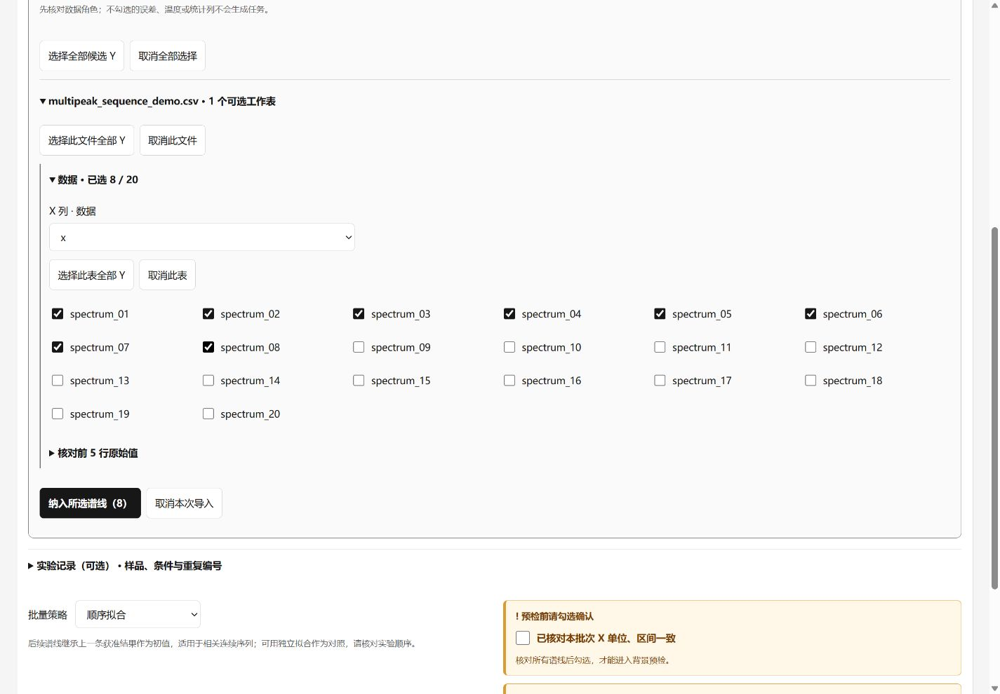

执行顺序可选择原始纳入顺序、文件名自然顺序、谱列名自然顺序，或兼容实验条件的数值顺序。先“预览排序”，核对后“应用此顺序”；仅预览不改变任务，应用后需重新预检。也可在映射表中逐条上下移动。运行后顺序锁定。单批使用同一峰数、峰形、约束、单位、区间与校准设置。

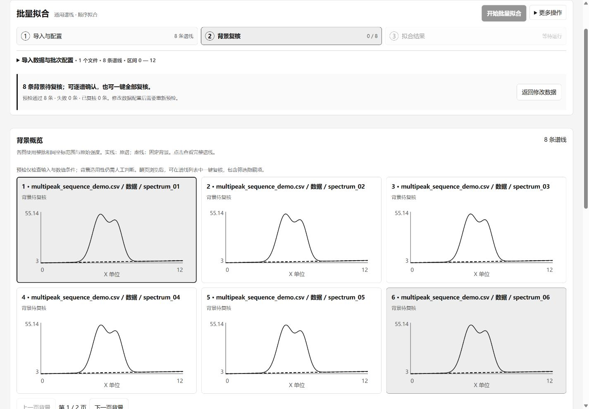

### 实验记录与峰参数趋势

在“实验记录（可选）”中填写样品编号、条件名称／值／单位和重复编号，可统一应用条件名称与单位。文本最多 200 字，条件值可留空；重复编号单独保存，不当作连续变量。页面刷新不会自动保存这些记录。

运行后，“峰参数趋势”按稳定峰 ID 比较峰顶位置、整体 FWHM、区间面积或全域面积。默认横轴为执行序号；所有纳入谱线的条件名称、单位一致且数值完整时，才能选择条件轴。不自动换算单位，不连线插值；同条件的重复样品保留独立点，不自动平均或生成置信区间。近乎恒定的数值使用带留白的纵轴，避免放大浮点尾差；原始数值与导出精度保持不变。

圆点表示未触发已实现诊断，三角表示警告／待复核，菱形表示人工接受，警告仍保留。失败、跳过、失效或缺失值显示“—”，不填零。图下等价表列出全部状态；图中点及表格“定位”均可返回对应原谱并突出该峰。表格支持键盘与容器内滚动。未做跨谱强度归一化，比较面积前须核对采集和预处理条件。

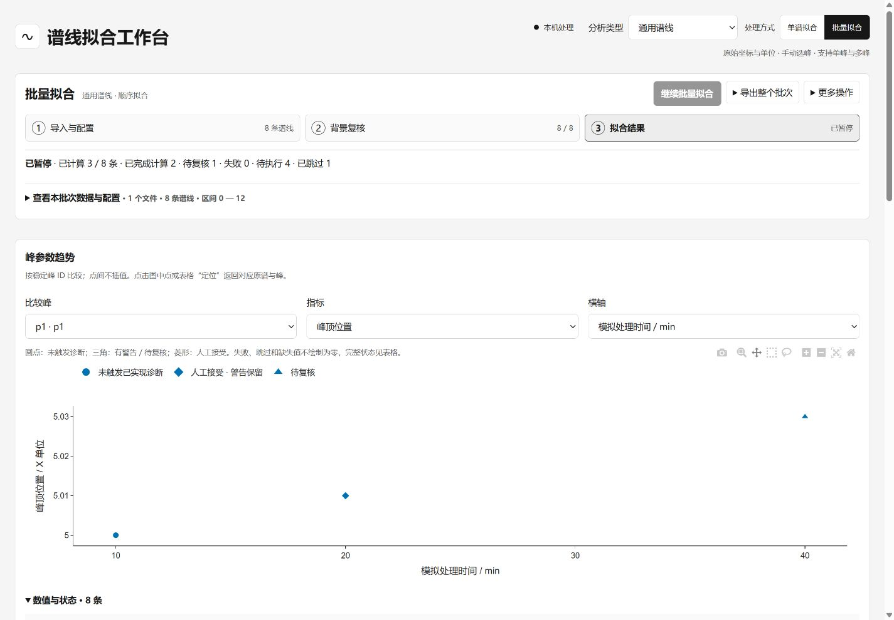

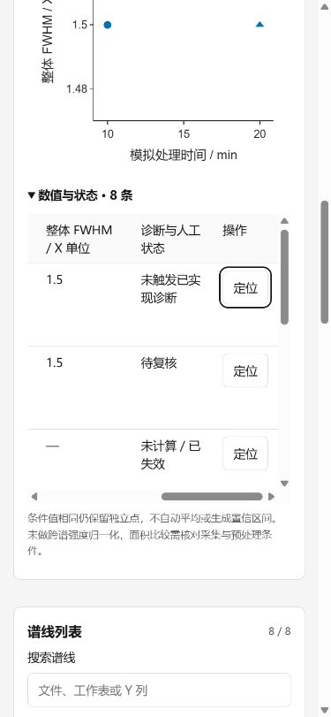

“更多操作 → 载入实验记录 JSON”只载入样品与条件记录。先在页面纳入相应原谱，再选择批次追溯文件；系统优先核对任务 ID 与来源，其次按原文件 SHA-256、工作表及 X/Y 列唯一匹配。重复来源无法唯一匹配、来源不符、未知版本或非法字段会整体拒绝，保留现有记录；覆盖已填写记录前会说明影响并确认。旧版本 1 识别为“未提供实验记录”，不会清空页面记录。载入不会恢复谱线、拟合结果、运行状态或后台任务，也不会自动拟合。

顶部流程条连接“导入与配置 → 背景复核 → 拟合结果”。预检完成后“导入数据与批次配置”默认折叠；“返回修改数据”只展开配置，保留现有复核，实际修改列映射、纳入项、顺序或相关选项后才使旧预检失效并返回导入阶段。预检前不展示空结果区。左侧支持按文件／工作表／Y 列搜索及状态筛选，点击谱线或使用上下方向键切换；右侧可用“上一条／下一条”浏览当前筛选结果，“下一个待复核”跳至全批次下一条待复核谱。筛选不会改变执行顺序，正常运行结束保留正在查看的谱线，异常暂停时定位到阻塞项。右侧集中展示曲线、残差、峰参数、尝试记录和配置；未拟合只显示原谱与背景，不显示空残差。图表默认聚焦拟合区间，可切换全谱、放大或导出 PNG；点击峰参数表中的峰名称可突出对应曲线并打开参数详情。窄屏时谱线列表与详情上下排列。

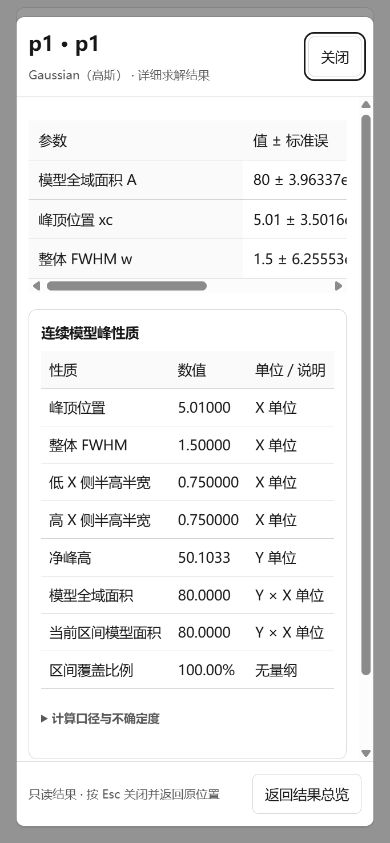

批量在当前浏览器会话内运行，刷新不会自动恢复；可先保存独立的本地会话 JSON，刷新后显式载入。输入限制为 100 条谱、累计 200,000 个有效点，并限制预估曲线元素总量；这些是资源保护上限，不是任何峰数／硬件下的性能承诺。跨谱共享参数联合拟合、自动峰数选择、后台运行及求解器内部迭代断点恢复尚未实现。会话恢复保留已完成结果，未完成的谱线在重新复核后从一次新求解开始。

### 合成示例与复算

导入 `examples/multipeak_sequence_demo.csv`，选 `x / spectrum_01`，选择“通用谱线”和“单谱拟合”，加载 `examples/multipeak_demo_configuration.json`。复核基线并拟合后，可建立批量模板，再导入同文件的 20 个 Y 列。本例各谱背景相同，可明确勾选“固定绝对背景”，再逐谱复核。

示例使用两个 Gaussian 峰，面积 80／50、FWHM 1.5／1.2，首谱中心 5／6.4，后续每谱中心增加 0.01；背景为 `3 + 0.2x`。数据为合成教学资料。

在项目根目录重新生成并验证首谱：

```powershell
.\.venv\Scripts\python.exe examples/reproduce_multipeak.py
```
