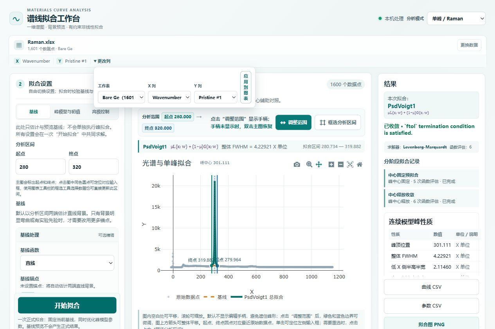
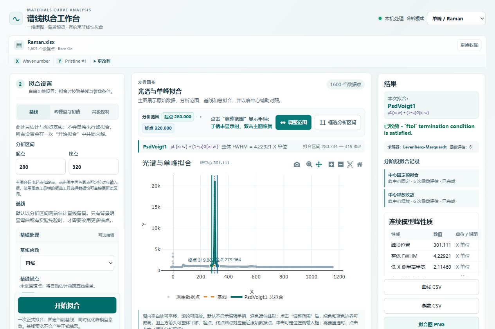
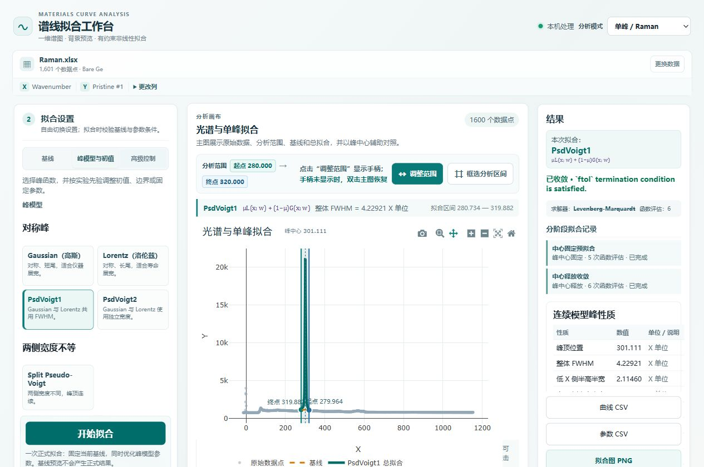
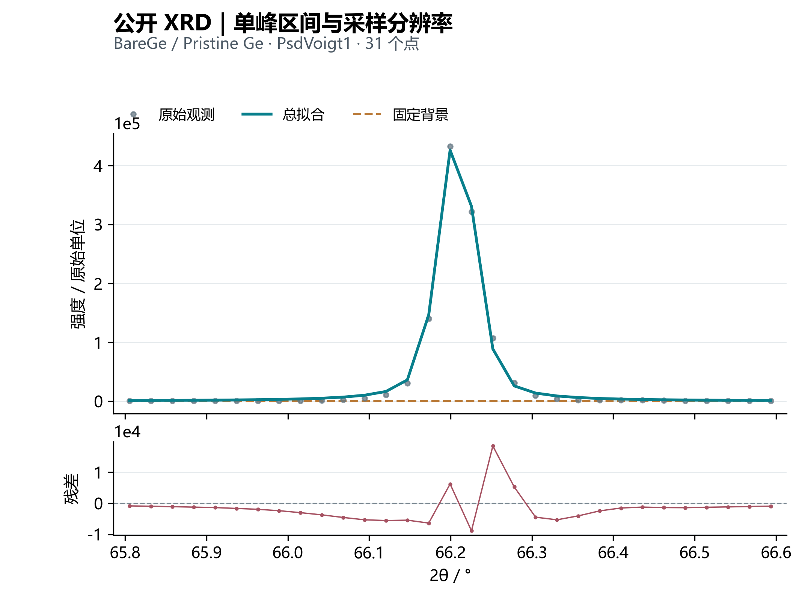
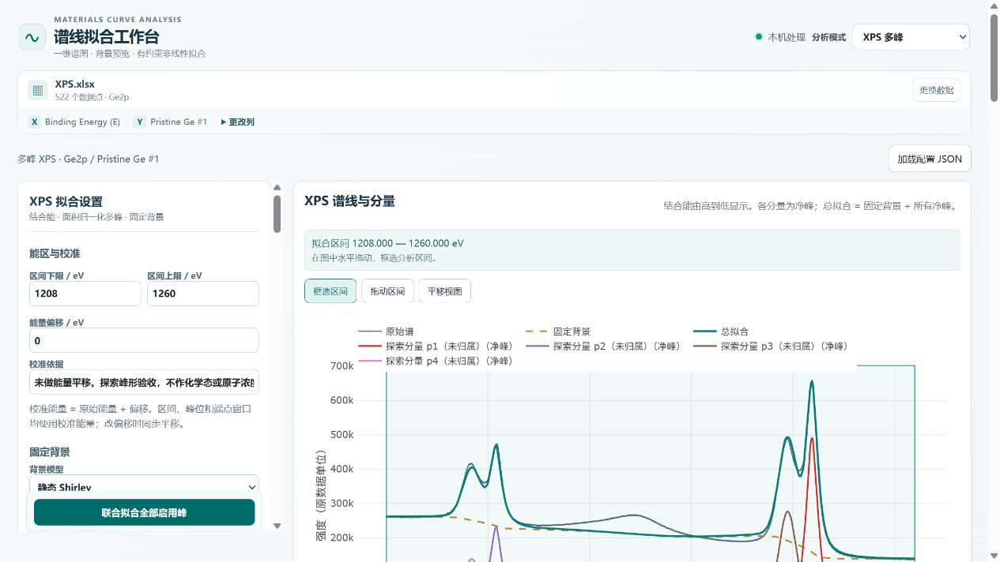
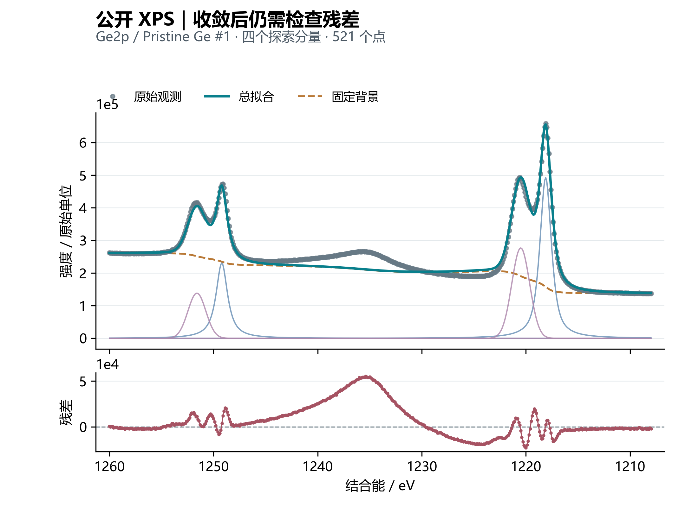
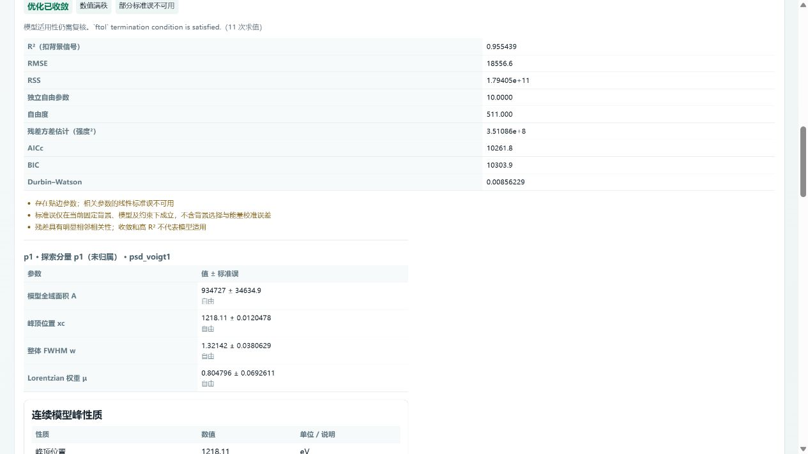

# 材料科研谱线拟合工具使用手册

适用对象：需要检查一维材料谱线峰位、峰宽、峰面积及拟合残差的使用者。本文依据当前仓库实现编写，更新日期为 2026-10-10。本版以已核验来源的公开 Raman、XRD、XPS 实谱演示操作，并附实际界面截图和拟合图。教学分析不代替原作者结论或化学态判断。

## 目录

1. [安装与启动](#安装与启动)
2. [首次拟合教程](#首次拟合教程)（公开 Raman 实谱）
3. [导入自己的数据](#导入自己的数据)
4. [单峰与 XRD 操作](#单峰与-xrd-操作)
5. [峰形与参数口径](#峰形与参数口径)
6. [XPS 多峰操作](#xps-多峰操作)
7. [读懂结果](#读懂结果)
8. [导出与恢复](#导出与恢复)
9. [常见问题](#常见问题)
10. [复现与实现依据](#复现与实现依据)

## 安装与启动

### 环境准备

Windows 启动脚本要求 Python 3.10～3.12，以及 Node.js 18 或更高版本（含 npm）。Python 推荐使用 3.11 或 3.12；依赖中的 NumPy 要求 `>=1.26,<2`，不要直接用 Python 3.13/3.14 创建环境。后端依赖范围见 `backend/requirements.txt`，前端锁定版本见 `frontend/package-lock.json`。

可在 PowerShell 检查：

```powershell
python --version
node --version
npm.cmd --version
```

下载项目后先解压到可写目录。以下命令均从项目根目录执行，不要求固定磁盘或用户名。

### Windows 一键启动

双击 `一键启动.bat`。脚本先检查 5175、5176 端口，然后创建或复用项目 `.venv`、安装后端依赖；缺少前端依赖时使用 `npm ci` 安装。首次安装需要联网。

启动后打开 <http://127.0.0.1:5175/>。保留启动窗口，结束时按回车；脚本只停止本次启动的服务。日志在 `.logs/`。也可以运行 `一键启动.bat -NoBrowser` 或 `一键启动.bat -Check`；后者在前后端返回 HTTP 200 后退出，不进行数值正确性验证。

### 手动安装与双终端启动

确认 `python --version` 在上述范围内，再安装：

```powershell
python -m venv .venv
.\.venv\Scripts\python.exe -m pip install -r backend/requirements.txt
cd frontend
npm.cmd ci
cd ..
```

第一个 PowerShell 窗口，在根目录启动后端：

```powershell
.\.venv\Scripts\python.exe -m uvicorn app.main:app --app-dir backend --host 127.0.0.1 --port 5176
```

第二个 PowerShell 窗口，从根目录进入前端并启动：

```powershell
cd frontend
npm.cmd run dev -- --host 127.0.0.1
```

访问 <http://127.0.0.1:5175/>。手动启动时分别在两个窗口按 Ctrl+C 停止。开发前端固定请求本机 5176 后端，因此不要只改后端端口后期待页面自动适配。

### 构建后单服务运行

完成依赖安装后，可先构建前端，再启动后端：

```powershell
cd frontend
npm.cmd run build
cd ..
.\.venv\Scripts\python.exe -m uvicorn app.main:app --app-dir backend --host 127.0.0.1 --port 5176
```

此时访问 <http://127.0.0.1:5176/>。后端在启动时检测 `frontend/dist` 并挂载静态页面；必须先构建、后启动。该方式仍面向本机，不是公网服务部署方案。

## 首次拟合教程

本教程采用 Gnatyuk 等公开的锗材料谱数据，数据集 DOI 为 [10.5281/zenodo.18845748](https://doi.org/10.5281/zenodo.18845748)，许可为 CC BY 4.0。原文件、完整署名、关联出版物、校验和与处理说明见[公开数据说明](../examples/public/README.md)。三份工作簿已随仓库提供，下载整个项目即可复现。

### 第一步：选对工作表和谱列

1. 点击“导入实验数据”，打开 [Raman.xlsx](../examples/public/zenodo_18845748/Raman.xlsx)。
2. 展开“更改列”，选择工作表 **Bare Ge**、X 列 **Wavenumber**、Y 列 **Pristine #1**，点击“应用到图表”。
3. 检查顶部文件名和列名。表格共 1601 行，数值清理后用于显示的有效配对点为 1600；两者不是同一统计口径。



**图 1｜导入与谱列核对。** 截图展示本例正确的工作表和 X/Y 选择，画面中同时保留了后续拟合结果。默认工作表 `Figure2bc` 存放峰位和峰宽统计，**不是待拟合原谱**。不要直接对默认选择开始拟合。

### 第二步：设置区间和基线

在“基线”页将起点设为 **280**、终点设为 **320**，输入后按 Tab 或点击其他控件，并检查主图上方的区间数值已同步。选择“直线”，本例不添加手动锚点，使用区间两端的自动估计；点击“查看自动基线（可选）”。



**图 2｜明确分析区间。** 输入的是 280～320 cm⁻¹，真正参与拟合的是其中的 52 个采样点，实际端点约为 280.734 和 319.882 cm⁻¹。主图仍可显示完整光谱，改变拟合区间并不等于自动缩放视图。

### 第三步：选择峰形并拟合

切换“峰模型与初值”，选择 **PsdVoigt1**，点击“自动分析并采用初值”，保持默认分阶段求解，点击“开始拟合”。本例没有手动固定参数或额外边界。



**图 3｜模型、状态和导出入口。** 左侧选择峰形，中间查看谱线，右侧读取收敛状态与峰性质。Raman 界面当前使用通用 X/Y 单位标识；本数据的 X 单位由原表确定为 cm⁻¹。

### 第四步：对照结果和残差

下面将同一次复算的拟合区间单独放大。上图保留所有区间内观测点，下图为观测值减总拟合；曲线连接模型在原采样点处的计算值，没有补造观测点。


**图 4｜局部峰形与残差。** 单条 `Pristine #1` 光谱，n=52 个谱点，不是 52 次独立实验。直线背景固定，PsdVoigt1 参数自由优化；未对原谱平滑、归一化或平均。没有绘制重复测量误差条。

| 复算项目 | 本例结果（约值） | 含义 |
| --- | --- | --- |
| 峰顶 xc | 301.11090 cm⁻¹ | 本模型的实际峰顶 |
| 整体 FWHM | 4.22921 cm⁻¹ | 当前背景和峰形下的半高全宽 |
| 全域面积 A | 115277.39 | 原始强度单位 × cm⁻¹；含区间外外推 |
| Lorentzian 比例 μ | 0.616777 | 峰形混合参数 |
| R² | 0.999497 | 高 R² 仍不能替代残差检查 |
| RMSE | 115.305 | 原始强度单位 |

这些数值仅用于核对操作路径，不是对整批样品的统计结论。导出“曲线 CSV”“参数 CSV”和“拟合图 PNG”；设置改变后须重新拟合。数值来源和完整精度见 [raman-result.json](../examples/public/results/raman-result.json)。

如需已知参数的练习，可继续使用[合成示例说明](../examples/README.md)中的 Gaussian 数据；它作为补充练习，不替代本实谱教程。

## 导入自己的数据

### 文件准备

支持 CSV、TXT、TSV、DAT、XY、XYE、XLS、XLSX、XLSM，单文件不超过 25 MiB。文本优先使用 UTF-8；读取器也尝试 GB18030，并自动推断分隔符。简单格式如下：

```csv
x,intensity
100,15.2
101,17.1
102,23.4
```

这三行只展示格式；单峰拟合区间至少需要四个有效点，实际谱线应有足够密集的采样。读取器支持无表头数值文本，以及以 `#`、`;`、`//` 开头的注释行。仪器二进制文件不能通过改后缀获得支持，应先在仪器软件中导出文本或表格。

Excel 可以选择工作表；表头应放在首行。导入后点击“更改列”可重新选择 X/Y。应用将所选列转换为数值，排除非有限值和无效配对行，然后按 X 升序排序。检查显示的点数和谱形是否符合预期。

### 坐标和数据质量

- Raman：X 使用实际波数；XRD：X 使用以度为单位的 2θ；XPS：X 使用结合能 eV。应用不转换单位。
- X 和 Y 必须是不同列。拟合区间内重复 X 会触发错误；请依据采集方式在外部处理重复测量。
- XYE 的第三列不会自动成为测量误差权重；当前工作流使用所选 X/Y。
- 不自动裁剪原始负强度，也不把残差负值归零。

上传数据存放在本机后端内存中。用于换列预览的数据登记会在创建约一小时后被后续请求清理；出现“数据已失效”时重新导入。刷新页面或停止服务前请保存原文件、结果和配置。

## 单峰与 XRD 操作

### 选择模式和区间

右上角选择“单峰 / Raman”或“XRD（单峰）”。两者共用数据和单峰设置，往返切换保留当前结果；XRD 以 2θ（°）标识横轴、峰位和 FWHM，不执行数据转换、晶相鉴定或晶粒尺寸计算。

在左侧输入区间起点和终点，或使用“框选分析区间”。点击“调整范围”后，可以拖动两侧边界，也可以通过上方箭头整体平移；点击“完成调整”或按 Esc 收起手柄。点击图中的起点、终点圆点可定位对应输入框。选择区间时保留足够背景，避免把相邻峰误纳入单峰解释。

### 公开 XRD 示例

导入 [XRD.xlsx](../examples/public/zenodo_18845748/XRD.xlsx)，选择 **BareGe → 2Theta → Pristine Ge**，点击“应用到图表”，再选择“XRD（单峰）”。注意这里的 `BareGe` **没有空格**。将区间设为 **65.8～66.6°**，使用无手动锚点的默认直线背景，选择 PsdVoigt1，采用自动初值后拟合。



**图 5｜XRD 单峰操作与采样限制。** 一条原谱的局部区间，n=31 个谱点；未做平滑、归一化或仪器展宽校正。复算峰顶约 **66.20816°**、FWHM 约 **0.05184°**、R² 约 **0.997326**。原谱步长约 0.02626°，一个 FWHM 只有约两个采样间隔，峰宽对模型和采样较敏感；不要把小数位数等同于测量精度，也不要直接用此宽度推断晶粒尺寸。线段连接模型采样值，尖锐外观不表示新增了实验点。

完整设置和输出见 [xrd-result.json](../examples/public/results/xrd-result.json)。

### 设定基线

基线先由锚点确定，拟合过程中固定；峰参数优化不会同时重新估计基线。

| 类型 | 输入要求 | 当前实现 |
| --- | --- | --- |
| 无基线 | 无锚点 | 基线恒为零，适合已完成背景校正的数据 |
| 常数 | 至少一个有效锚点 | 使用锚点 Y 的平均值 |
| 直线 | 至少两个不同 X 的锚点 | 连接最左和最右锚点；额外内部锚点不改变直线 |
| 多项式 | d 阶需要至少 d+1 个不同 X 的锚点，d 为 1～8 | 对锚点拟合多项式 |
| Spline | 至少三个不同 X 的锚点 | 三次插值样条；锚点覆盖范围外保持端点值 |
| B-Spline | 至少四个不同 X 的锚点，平滑强度非负 | 平滑样条；覆盖范围外保持端点值 |

将锚点放在有依据的背景位置，核对图中编号和输入坐标；重复 X 不计为独立约束，后端会拒绝重复锚点。使用建议锚点时，需要勾选“我已复核建议锚点”。“查看自动基线（可选）”用于检查当前配置计算的基线，并不证明背景选择正确。

未提供手动锚点时，界面允许的默认直线流程可使用区间端点估计。端点若仍有明显峰尾，应调整区间或手动指定锚点。提高多项式阶数不保证更可靠，过于灵活的基线可能吸收真实峰信号。

### 初值、约束与求解

选择峰模型后，可用“自动分析并采用初值”估计参数。自动分析只提供候选和起点，不是最终拟合，也不自动确认峰的物理来源。

在“参数初值与约束”中填写初值、下限、上限；上下限留空时使用模型边界。“固定”表示该参数不参与优化。初值必须位于允许范围内，宽度必须满足模型要求。

“分阶段拟合”可先固定峰中心进行预拟合，再释放中心。默认中心固定阶段上限为 20 次、最大函数评估次数为 2000、容差为 `1e-8`。求值次数并非实验重复次数；遇到失败，先检查数据、基线、峰形和约束，再决定是否增加上限。

改变区间、基线或参数后，旧结果可保留用于对照，但会标记待复核并禁用导出；重新拟合后才能导出当前结果。

## 峰形与参数口径

统一术语：`A` 为**模型全域积分面积**，`xc` 为**实际峰顶位置**，FWHM 为**半高全宽**，HWHM 为**半高半宽**，`mu`（μ）为 Lorentzian 混合比例。面积单位为 Y 单位乘 X 单位，净峰高使用 Y 单位，宽度和峰位使用 X 单位。

| 模型 | 主要参数 | 宽度解释 |
| --- | --- | --- |
| Gaussian | A、xc、w | w 是整体 FWHM |
| Lorentz | A、xc、w | w 是整体 FWHM |
| PsdVoigt1 | A、xc、w、mu | Gaussian 和 Lorentz 分量共用 w，w 是整体 FWHM |
| PsdVoigt2 | A、xc、wG、wL、mu | wG、wL 是两个分量各自的 FWHM；整体 FWHM 另行计算 |
| Split Pseudo-Voigt | A、xc、h_low、h_high、mu | 两侧 HWHM 不同，整体 FWHM = h_low + h_high |
| EMG（高 X / 低 X 拖尾） | A、xc、sigma、tau | sigma 是高斯核标准差，tau 是指数尾尺度，两者均不等于整体 FWHM |

EMG 在 `tau=0` 时退化为 Gaussian。拖尾方向按 X 数值增减定义，XPS 倒序横轴不改变这个定义。本项目的 Split Pseudo-Voigt 归一化和 EMG 峰顶重定位有具体实现，不能直接套用其他软件同名模型的参数。

“连续模型峰性质”从连续函数计算整体 FWHM、两侧半宽、净峰高、全域面积、当前区间模型面积和区间覆盖比例。区间积分使用实际参与拟合的数据端点与解析原函数/CDF；全域面积包含区间之外的模型外推。半高交点超出数据范围时会提示，不能将其当作已充分测量的峰宽。

旧字段 `derived_parameters.area_in_range` 使用采样点梯形积分；新字段 `peak_geometry.area_in_range` 使用模型积分。两者不能混为同一数值口径。无有效宽度时返回空值和原因；派生峰性质暂不报告标准误或置信区间。

## XPS 多峰操作

### 一次完整分析

1. 导入结合能和强度数据，在“更改列”中选择对应列，再切换到“XPS 多峰”。横轴从高能向低能显示。
2. 输入区间下限和上限，或在图中框选。“拖动区间”改变分析范围，“平移视图”只改变可见视图。
3. 选择无背景、直线或静态 Shirley。可手填低/高能端水平，也可留空采用相应端点窗口的中位数。区间变化后按需点击“窗口重置到区间两端”。
4. 点击“预览背景”。使用 Shirley 时，检查后勾选“已复核当前 Shirley 背景”，才能拟合。
5. 点击“添加单峰”，或“检测候选峰”后逐个选择。调整标签、峰形、初值、边界和固定参数。候选只提供初值；后续预览不会覆盖人工初值。
6. 有独立依据时设置峰组关系，然后点击“联合拟合全部启用峰”。图中分量为净峰，总拟合只叠加一次背景。
7. 检查各分量、总拟合、残差和参数状态，保存结果与配置。改变设置后重新拟合再导出。

### 公开 XPS 示例：恢复配置、检查背景和诊断

1. 导入 [XPS.xlsx](../examples/public/zenodo_18845748/XPS.xlsx)，选择 **Ge2p → Binding Energy (E) → Pristine Ge #1**，点击“应用到图表”，切换“XPS 多峰”。
2. 点击“加载配置 JSON”，选择仓库内的 [xps-ge2p-configuration.json](../examples/public/xps-ge2p-configuration.json)。该文件含原文件 SHA-256 和原始数组，已在当前界面验证能匹配原谱。
3. 核对区间 **1208～1260 eV**、偏移 **0 eV**、背景 **静态 Shirley**。低能端水平为 **137693**、高能端水平为 **260451**，本例使用明确数值而非自动端点窗口。
4. 点击“预览背景”，复核后勾选“已复核当前 Shirley 背景”。配置载入不会跳过这个步骤。
5. 点击“联合拟合全部启用峰”，检查四个探索分量、总谱和残差。



**图 6｜XPS 工作台与配置入口。** 图中使用公开 `Ge2p / Pristine Ge #1` 原谱，结合能从高到低显示。四个分量仅作探索性分解，未命名为任何化学态。

| 初始参数 | p1 | p2 | p3 | p4 |
| --- | --- | --- | --- | --- |
| A（原始强度 × eV） | 893144.91 | 426718.61 | 585485.63 | 313086.72 |
| xc / eV | 1218.1 | 1249.2 | 1220.6 | 1251.7 |
| w / eV | 1.3 | 1.3 | 1.8 | 1.8 |
| μ | 0.35 | 0.35 | 0.35 | 0.35 |

各峰中心边界为初值 ±1.5 eV，宽度边界 0.15～6 eV。p2 绑定 p1，p4 绑定 p3：中心偏移 31.1 eV、面积比 0.5、宽度比 1；被绑定参数的输入初值随后由关系展开决定。这些是本教学配置的约束，不是已验证的化学态先验，也不能直接照搬到其他数据。



**图 7｜为什么“已收敛”还不够。** n=521 个谱点，四个 PsdVoigt1 净峰与固定 Shirley 背景联合显示；蓝色细线为第一组两个净峰，紫色细线为第二组两个净峰，总拟合仅加一次背景。没有进行归一化、位置间平均或平滑。1235 eV 左右仍有显著宽残差，不应当作随机噪声忽略。



**图 8｜保留不理想结果，演示如何复核。** 本例 R² 约 **0.955439**，但 Durbin–Watson 仅约 **0.00856**；`p3.mu` 和 `p4.mu` 贴边，相关标准误不可用。数值满秩、优化收敛与模型适用性是不同判断。本例用于教学配置恢复和诊断，**不能用于确认化学态或可靠组分定量**。完整结果见 [xps-result.json](../examples/public/results/xps-result.json)。

### 峰组和约束

“添加双峰组（同宽）”使用你给出的峰间距与第二峰/第一峰面积比，不预设元素。可创建峰位偏移、面积比例和宽度比例关系：

```text
目标峰.xc = 来源峰.xc + 偏移值
目标峰.A  = 来源峰.A  × 面积比例
目标峰.w  = 来源峰.w  × 宽度比例
```

同类宽度关联支持 `w↔w`、`h_low↔h_low`、`h_high↔h_high`、`sigma↔sigma`；`tau` 可设初值、边界或固定值。被绑定参数通过独立根参数展开，子参数边界会传播到根参数。约束冲突、循环关联或停用被引用的来源峰会阻止有效求解。

删除被关联峰前，先点击“解除该峰的所有关联”；切换峰形遇到不兼容关系时，也应先解除冲突。增加峰数会增加参数，并不自动增加解释可信度。

### 能量校准与 Shirley 的含义

能量偏移采用 `E_corrected = E_raw + shift_eV`，同步平移区间、端点窗口和峰位。填写“校准依据”；应用不会自动判断荷电校正。

静态 Shirley 在能量升序上迭代：

```text
B(E) = B_low + (B_high − B_low) × ∫low^E(y − B)dE / ∫low^high(y − B)dE
```

积分使用真实采样步长。背景计算后固定，不随峰参数优化更新。净积分非正或背景不收敛会报错，不自动回退到其他背景模型。参数误差也不包括背景选择或校准的不确定性。

## 读懂结果

先判断优化是否收敛，再检查参数是否可辨识，最后结合实验依据判断模型是否适用。这三个问题不能用一个 R² 代替。

| 指标或提示 | 解释与操作 |
| --- | --- |
| R²、调整 R² | 描述当前模型对数据变异的解释程度；不能据此确认物理机制 |
| RMSE、SSE/RSS | 残差尺度与残差平方和；比较时保持同一数据和预处理 |
| 残差方差估计 | 无权重的残差平方和/自由度，单位为强度²，不是已按测量误差标准化的 χ² |
| 残差趋势、Durbin–Watson、异常点 | 诊断线索；仍需观察结构性偏离、局部肩峰和背景错误 |
| AICc、BIC | 在可比的数据、区间、背景和权重条件下比较模型；AICc 点数不足时为空 |
| 参数贴边、秩不足、标准误为空 | 查看原因并复核约束或模型；空值不是零误差 |
| 区间覆盖比例不足、半高点超界 | 提示外推对面积/宽度的影响；按实验条件扩大测量或分析范围 |

模型比较默认比较四种对称单峰；勾选“加入非对称模型”后扩展为七种。推荐结果不会自动替换当前选择；需要自行选择模型并重新拟合。

XPS 的 R² 使用扣背景信号。EMG 自由尾尺度很小（`tau/sigma < 1e-3`）时会提示弱尾，不报告不适用的线性标准误；`tau` 固定为零时，可辨识的 Gaussian 宽度仍可估计误差。标准误和置信区间都依赖当前模型、约束和固定背景。

XPS 面积占比使用当前能区内启用分量的积分面积总和作分母，**不是元素原子百分比**。当前不支持 Tougaard、多重态专用模型、自动化学态归属、RSF 定量、测量误差加权和批量联合拟合。

## 导出与恢复

### 输出内容

| 文件 | 用途 |
| --- | --- |
| 单峰曲线 CSV | `x, raw_y, baseline, net_y, peak_y, total_y, residual` |
| 单峰参数 CSV | 参数、误差、边界、固定状态、拟合设置、统计量及 `geometry.*` 峰性质 |
| XPS 曲线 CSV | 原始/校准能量、原始强度、背景、分量、净峰总和、总拟合、残差 |
| XPS 参数 CSV | 分量参数、约束相关状态、统计量和峰性质 |
| XPS 配置 JSON | 保存当前源信息、数组与分析配置，供严格匹配后重新拟合 |
| PNG | 导出当前拟合谱图，用于展示；不代替数值结果归档 |

建议把原始文件、参数 CSV、曲线 CSV、PNG 和 XPS 配置保存在同一分析目录，并记录样品、采集条件、单位、校准依据、软件提交版本和分析日期。单峰界面没有配置 JSON 的保存/恢复入口，应额外记录设置。

### 恢复 XPS 配置

1. 重新导入**原始文件**，选择原工作表和原 X/Y 列。
2. 切换 XPS，点击“加载配置 JSON”。支持配置导出文件，也支持含 `configuration` 的 XPS 拟合结果 JSON。
3. 应用严格核对文件 SHA-256、工作表、谱列和原始数组。Excel 即使数值未变，重新保存后文件字节也可能变化，导致校验失败。
4. 载入后复核背景，必要时重新勾选 Shirley 复核，再执行拟合。文件中的旧结果不会被直接当作当前可信结果。

旧峰形和旧参数配置使用版本 1；包含新峰形或新参数时使用版本 2。当前支持版本 1/2，内外版本必须一致。不要手改版本号绕过校验。

切换单峰/XPS 模式保留各自状态，换谱会清空 XPS 设置。刷新页面不会自动恢复会话。结果失效时导出被禁用；XPS 导出接口会依据完整配置重新求解，避免导出过期结果。

## 常见问题

| 现象 | 排查方法 |
| --- | --- |
| 未找到 Python 或 NumPy 安装失败 | 检查是否为 Python 3.10～3.12；更换解释器后须为项目重新创建兼容环境 |
| 无法运行 npm.ps1 | PowerShell 中使用 `npm.cmd`；一键脚本已使用此入口 |
| 端口 5175/5176 被占用 | 回到之前的启动窗口停止旧服务；不要结束来源不明的进程 |
| 页面打开但导入/拟合失败 | 检查后端窗口、`.logs/backend-error.log`，确认后端监听 5176 |
| “数据已失效”或刷新后空白 | 重新导入原文件并选择列；XPS 可在匹配后加载已保存配置 |
| 找不到数值列或 X/Y 相同 | 检查表头、分隔符、所选工作表与列；先在表格软件确认内容 |
| 重复 X、锚点重复或点数不足 | 调整区间，检查数据与锚点；满足当前模型所需的有效独立信息 |
| 拟合按钮不可用 | 先显示数据；XPS 需启用至少一个峰，Shirley 需预览并复核；检查界面错误提示 |
| Shirley 净积分非正或不收敛 | 检查区间、端点窗口和端点水平，确认背景选择有依据 |
| 参数贴边、误差为空、曲线局部偏离 | 复核初值、边界、背景和峰数，不仅增加求值次数 |
| 配置与原谱不匹配 | 使用原始字节一致的文件、原工作表和原谱列；不能仅凭文件名相同判断 |
| 导出按钮变灰 | 设置已改变，重新拟合当前配置 |
| 旧 PsdVoigt2 结果没有整体 FWHM | 用当前版本重新拟合；wG/wL 不是整体 FWHM |

## 复现与实现依据

核心单元测试和前端构建命令见根目录 README。测试可检查数值实现、约束和交互回归，不能为未知实谱提供化学态或参数真值。

公开原谱已收入 `examples/public/zenodo_18845748/`。本次手册的复算脚本不依赖历史分析目录，在项目根目录运行：

```powershell
.\.venv\Scripts\python.exe examples/public/reproduce.py
```

脚本核对原文件后，重新生成 `examples/public/results/` 中的三类拟合结果、曲线 CSV、参数 CSV 和汇总。它会覆盖这些派生结果，不改变原文件。可选绘图命令、字体要求、来源署名和处理范围见[公开数据复现说明](../examples/public/README.md)。

旧的 `backend/tests/validate_*_real.py` 等历史回放仍依赖 `data/analysis/` 的档案，不能用新教程脚本的通过状态替代其验收。本次截图通过真实界面操作取得，三张数据图由当前后端复算 JSON 生成；图片保留完整拟合区间内的所有有效采样点。

本文的主要行为可在以下源码中核对：

| 内容 | 实现位置 |
| --- | --- |
| 文件格式、数值清理、排序 | `backend/app/datasets.py` |
| 上传限制、内存登记、CSV 导出、静态页面 | `backend/app/main.py` |
| 锚点基线与拟合流程 | `backend/app/baselines.py`、`backend/app/fitting.py` |
| 峰形和连续峰性质 | `backend/app/peaks.py`、`asymmetric.py`、`peak_properties.py` |
| XPS 背景、约束和求解 | `backend/app/xps_backgrounds.py`、`xps_constraints.py`、`xps_fitting.py` |
| 配置恢复和状态失效 | `frontend/src/xpsState.ts`、`components/XpsWorkbench.vue` |
| 单峰控制、比较和导出入口 | `frontend/src/components/FitControls.vue`、`ResultsPanel.vue` |

手册采用 nature-skills 中 nature-writing 的证据对应、术语一致和边界表述原则；功能说明以当前源码为依据，不将论文写作风格当作软件或科研结果认证。
